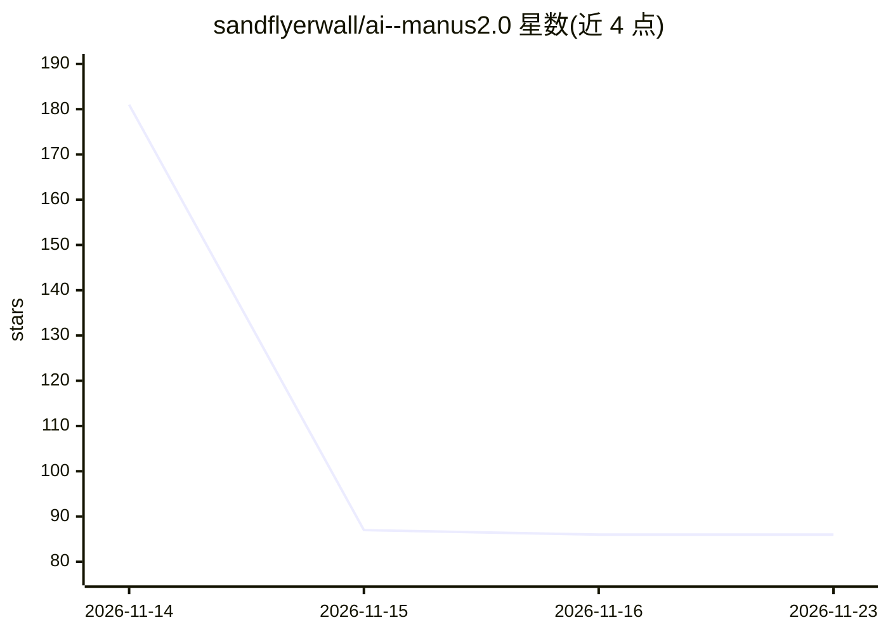

# sandflyerwall/ai--manus2.0

⭐ 86 · Apache-2.0 · 推送 2026-11-15 · [GitHub](https://github.com/sandflyerwall/ai--manus2.0) · 个人维护

**面向日常小任务的自主 AI Agent，可执行代码与控制浏览器**

Manus 是一个自主 AI agent，宣称可代替用户执行代码脚本、控制浏览器（导航网页、填表、采集信息）并完成多步骤任务，定位为家庭、学习与轻度办公场景的后台个人助手，而非企业级平台。README 给出系统兼容性表（最低双核 CPU、4GB 内存）与上手步骤（配置、测试、自定义自动/确认的任务类型）。注意：README 未给出具体的安装命令、模型接入方式或代码仓库结构，仅含『Download Manus』与优惠码『PROMO2026』字样及 SEO 关键词列表，技术可验证信息有限。

## 筛选速览

| 维度 | 判定 | 备注 |
|---|---|---|
| AI 角色 | `ai-native` | 本体是模型或模型工具 |
| 许可风险 | `permissive` | Apache-2.0 |
| 部署形态 | `None` |  |
| 模型依赖 | — | README 未给出锁定关系 |
| 硬件要求 | — | 无带数字的原话,不猜 |
| 安装摩擦 | `low` | 无编译、无系统依赖或容器化 |
| 成熟度 | — | 结构信号不足 |

## 能力要点

- 自主执行代码与脚本完成多步骤任务
- 浏览器控制：导航网页、填表、采集信息
- 代码与浏览器动作可在同一工作流中衔接
- 会话间保持任务模式的一致性（README 自述）

## 适用场景

- 让 agent 代为查网页、填表、收集资料
- 自动处理重复性的小任务（整理笔记、文件检查）
- 作为学生或远程工作者的后台个人助手

## 场景标签

`AI 助手` `浏览器自动化` `编码 Agent` · 领域:效率与自动化

## 证据(README 行号)

> L10: - **Autonomous Code Execution:** Manus AI agent runs code on its own to complete tasks, so you can focus on decisio
> L18: Manus is an autonomous AI agent designed to run code and control a browser on your behalf. Instead of acting like a

## 星数曲线

2026-11-14 181 → 2026-11-23 86（-95）

---
*卡片 v1 · prompt 1.4 · 生成 2026-11-17 · 置信度 low · 依据 README sha `637da4fbcded` · [字段定义](../../DATASET.md)*
