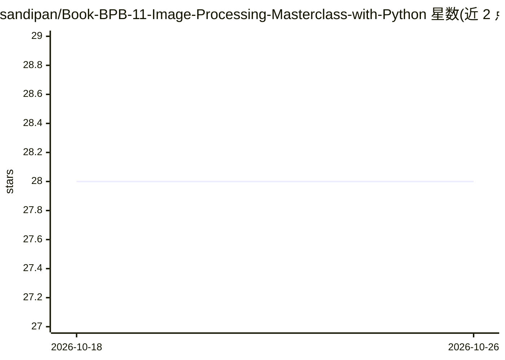

# sandipan/Book-BPB-11-Image-Processing-Masterclass-with-Python

⭐ 28 · Jupyter Notebook · MIT · 推送 2026-07-05 · [GitHub](https://github.com/sandipan/Book-BPB-11-Image-Processing-Masterclass-with-Python) · [官网](https://www.amazon.com/Image-Processing-Masterclass-Python-Techniques/dp/9389898641/) · 个人维护

**图像处理图书配套代码库：60+问题的Python解法**

BPB 出版图书《Image Processing Masterclass with Python》的代码仓库，提供 60 多个图像处理与计算机视觉问题的解法，其中 50+ 用经典算法、其余用 ML/DL 模型求解。内容覆盖几何变换、图像哈希、采样、卷积、离散傅里叶变换、频域滤波、反卷积图像复原、空间滤波增强、SRGAN 超分辨率及人脸检测/识别/解析（dlib、MTCNN）。使用的库包括 Numpy、Scipy、scikit-image、PIL、SimpleITK、scikit-learn、Keras、PyTorch，并演示 Microsoft Cognitive Vision API。面向计算机视觉用户、机器学习工程师与图像处理从业者。README 未给出具体安装运行命令。

## 筛选速览

| 维度 | 判定 | 备注 |
|---|---|---|
| AI 角色 | `ai-knowledge` | 知识聚合/清单类 |
| 许可风险 | `permissive` | MIT |
| 部署形态 | `None` |  |
| 模型依赖 | — | README 未给出锁定关系 |
| 硬件要求 | — | 无带数字的原话,不猜 |
| 安装摩擦 | `low` | 无编译、无系统依赖或容器化 |
| 成熟度 | — | 结构信号不足 |

## 能力要点

- 60+ 图像处理/计算机视觉问题的代码解法
- 经典算法与 ML/DL 模型（含 SRGAN、MTCNN、dlib）并用
- 覆盖频域滤波、图像复原、图像哈希等主题

## 适用场景

- 按书章节实践图像处理算法的实现
- 查阅人脸检测/识别等问题的 Python 解法参考代码
- 学习 Numpy/Scipy/scikit-image 等 Python 图像库的用法

## 场景标签

`图像视频处理` `人脸识别` · 领域:感知与多模态

## 证据(README 行号)

> L3: This is the code repository for Image Processing Masterclass with Python: 50+ Solutions and Techniques Solving Compl
> L5: Over 60 problems / solutions to help you perform complex image processing and computer vision tasks with ease

## 星数曲线

2026-10-18 28 → 2026-10-26 28（+0）

---
*卡片 v1 · prompt 1.4 · 生成 2026-10-26 · 置信度 high · 依据 README sha `f10cf243d1ba` · [字段定义](../../DATASET.md)*
