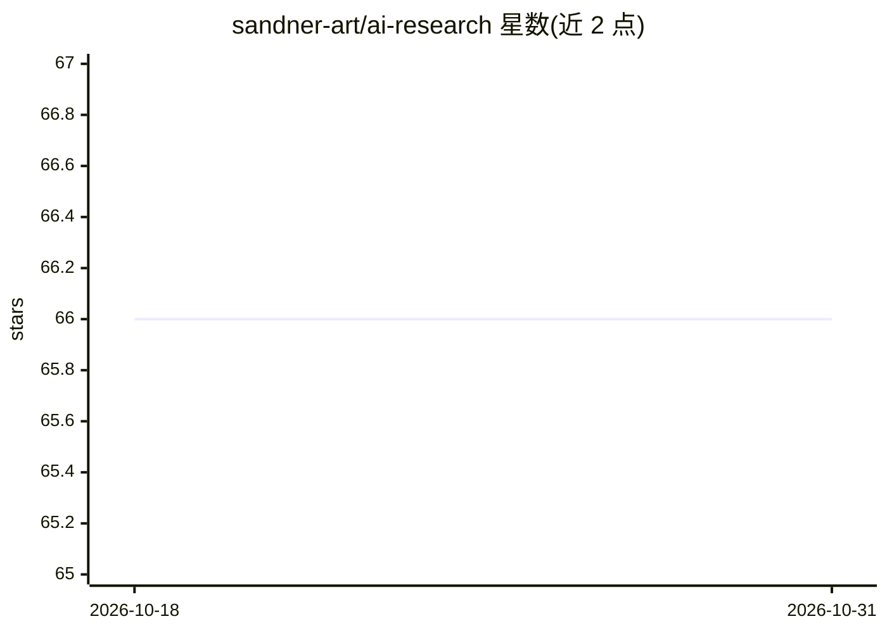

# sandner-art/ai-research

⭐ 66 · Batchfile · GPL-3.0 · 推送 2025-11-15 · [GitHub](https://github.com/sandner-art/ai-research) · 个人维护

**AI 图像生成训练的配置与工作流设置集合**

由 sandner-art 维护的仓库，存放用于 AI 训练的工作流、环境设置与配置文件，围绕 Kohya WebUI、LoRA 训练与 Stable Diffusion WebUI 展开。仓库声明这些工具可无限制用于创意工作与艺术创作，相关文章作品采用 CC BY 4.0 许可。README 极简，未提供安装或使用说明，仅说明可通过 Issues 提问交流设置与工作流问题。

## 筛选速览

| 维度 | 判定 | 备注 |
|---|---|---|
| AI 角色 | `ai-ecosystem` | LLM/agent 周边工具 |
| 许可风险 | `viral` | GPL-3.0 |
| 部署形态 | `None` |  |
| 模型依赖 | — | README 未给出锁定关系 |
| 硬件要求 | — | 无带数字的原话,不猜 |
| 安装摩擦 | `low` | 无编译、无系统依赖或容器化 |
| 成熟度 | — | 结构信号不足 |

## 能力要点

- 提供 AI 训练相关的工作流、设置与配置文件
- 工具可无限制用于创意工作，文章作品 CC BY 4.0 许可
- 通过 GitHub Issues 支持设置与工作流问答

## 适用场景

- 查找 Kohya WebUI / LoRA 训练的参考配置
- 获取 AI 图像生成的训练工作流设置
- 在 Issues 中询问特定设置或工作流问题

## 场景标签

`图像生成` `微调` · 领域:内容生成

## 证据(README 行号)

> L5: **Tools in this repository:** Workflows, setups, configs. You may use the tools for your creative work and art witho

## 星数曲线

2026-10-18 66 → 2026-10-31 66（+0）

---
*卡片 v1 · prompt 1.4 · 生成 2026-10-24 · 置信度 low · 依据 README sha `b800b51bdf1e` · [字段定义](../../DATASET.md)*
