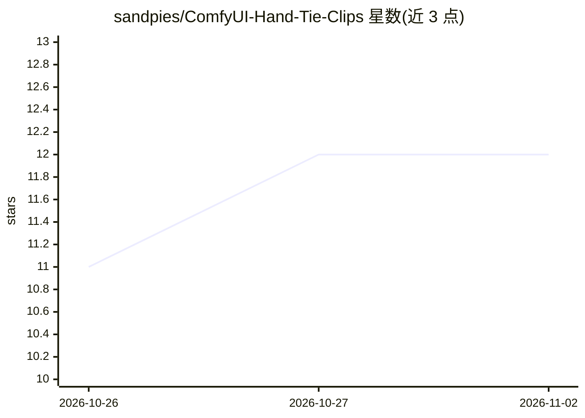

# sandpies/ComfyUI-Hand-Tie-Clips

⭐ 12 · Python · MIT · 推送 2026-10-30 · [GitHub](https://github.com/sandpies/ComfyUI-Hand-Tie-Clips) · [官网](https://registry.comfy.org/nodes/comfyui-hand-tie-clips) · 个人维护

**ComfyUI 节点包：将 MiniMax H3 生成串成保持角色一致的多镜头连续视频**

面向 MiniMax H3 视频模型的 ComfyUI 自定义节点包：以镜头卡片编写多跳（hop）脚本，在可视化轨道管理最多 9 张参考图与语音，通过 motion_context 潜空间接力或 hand_tie 预编译桥接把多段生成连成单一连续长片，支持锁定/单镜头重拍（无损缓存）、引导式角色/头部替换、realism_boost 两阶段采样与 2MP 平铺放大。WRITE 标签页可连接本地 OpenAI 兼容服务（LM Studio/llama.cpp 等）起草镜头卡，标注为实验性。安装方式为 git clone 到 custom_nodes 目录，无 pip 依赖，需另下载放大器权重等可选模型文件。

## 筛选速览

| 维度 | 判定 | 备注 |
|---|---|---|
| AI 角色 | `ai-native` | 本体是模型或模型工具 |
| 许可风险 | `permissive` | MIT |
| 部署形态 | `None` |  |
| 模型依赖 | — | README 未给出锁定关系 |
| 硬件要求 | — | 无带数字的原话,不猜 |
| 安装摩擦 | `low` | 无编译、无系统依赖或容器化 |
| 成熟度 | `idea` | |

## 能力要点

- motion_context / hand_tie 两种拼接机制，把多跳生成连成无切闪的连续片段
- 镜头锁定与单跳重拍，基于无损缓存复用已渲染片段
- realism_boost 两阶段采样、audio_refine 音轨重采样、2MP 平铺放大（Regen2K LoRA）
- WRITE 起草助手可连接本地 OpenAI 兼容服务生成/编辑镜头卡（实验性）

## 适用场景

- 在 ComfyUI 中生成保持角色与外观一致的多镜头短片或音乐视频
- 对不满意的单个镜头重拍而不重渲染整条链
- 用参考图与语音片段驱动带口型同步的视频生成

## 场景标签

`视频生成` · 领域:内容生成

## 证据(README 行号)

> L14: **Multi-hop MiniMax H3 video from one ComfyUI node.** Author shot cards, manage reference stills and voices on a vi
> L36: |**🎬 SCRIPT** (`Simple` & `Shots`)|Switch to **`Simple`** mode (`chains = 1`) to paste standard **MiniMax H3 `ref2v

## 星数曲线

2026-10-26 11 → 2026-11-02 12（+1）

---
*卡片 v1 · prompt 1.4 · 生成 2026-11-01 · 置信度 high · 依据 README sha `33eb58d51c2a` · [字段定义](../../DATASET.md)*
