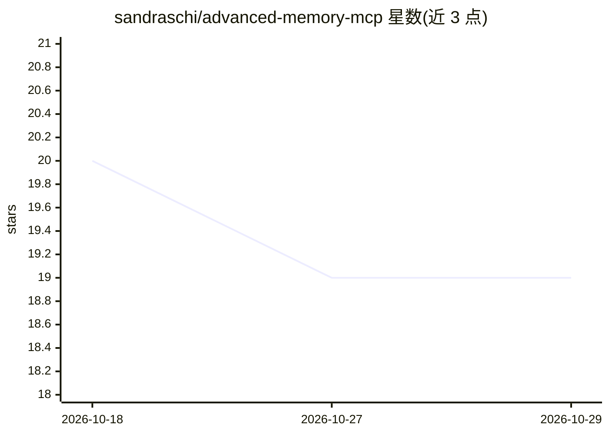

# sandraschi/advanced-memory-mcp

⭐ 19 · Python · MIT · 推送 2026-10-26 · [GitHub](https://github.com/sandraschi/advanced-memory-mcp) · 个人维护 · 中文 README

**给 MCP 助手提供持久记忆的知识管理服务器**

基于 FastMCP 3.2 GA（Python 3.12+）的 MCP 服务器，为 AI 助手提供跨会话的持久知识存储：79 个工具分 12 组，覆盖全文检索+RAG、笔记 CRUD、Zettelkasten 生成分析、技能管理、语音识别/合成等。本地优先，用 SQLite + LanceDB 做向量检索，无需外部 API。支持 stdio（Claude Desktop/Cursor）与 HTTP/SSE（Web 仪表盘）双传输，另提供浏览器 webapp。安装走 git clone + just 引导。

## 筛选速览

| 维度 | 判定 | 备注 |
|---|---|---|
| AI 角色 | `ai-ecosystem` | LLM/agent 周边工具 |
| 许可风险 | `permissive` | MIT |
| 部署形态 | `None` |  |
| 模型依赖 | — | README 未给出锁定关系 |
| 硬件要求 | — | 无带数字的原话,不猜 |
| 安装摩擦 | `low` | 无编译、无系统依赖或容器化 |
| 成熟度 | — | 结构信号不足 |

## 能力要点

- 79 个 MCP 工具分 12 组（检索/RAG、笔记、Zettelkasten、技能、音频等）
- 本地优先：SQLite + LanceDB 向量检索，外部 API 不需要
- stdio 与 HTTP/SSE 双传输，附浏览器 webapp
- Claude Code 钩子支持会话开始时自动召回

## 适用场景

- 让 Claude Desktop 或 Cursor 等 MCP 客户端跨会话保留笔记与研究资料
- 对自己的内容做语义检索和 RAG
- 用 Zettelkasten 方式组织知识并管理 agent 技能

## 场景标签

`知识库管理` `RAG` `Agent 记忆` · 领域:Agent 开发

## 证据(README 行号)

> L15: - **Why** — Give an MCP-capable assistant a **durable place** for notes, research, and retrieval: search and RAG ov
> L16: - **What** — A **FastMCP 3.2 GA** server (Python 3.12+) exposing **79 tools across 12 Industrial Portmanteaus** (`a
> L55: - **ローカルファースト** — SQLite + LanceDBベクトル検索、外部API不要

## 星数曲线

2026-10-18 20 → 2026-10-29 19（-1）

---
*卡片 v1 · prompt 1.4 · 生成 2026-10-28 · 置信度 high · 依据 README sha `e413e97b0b60` · [字段定义](../../DATASET.md)*
