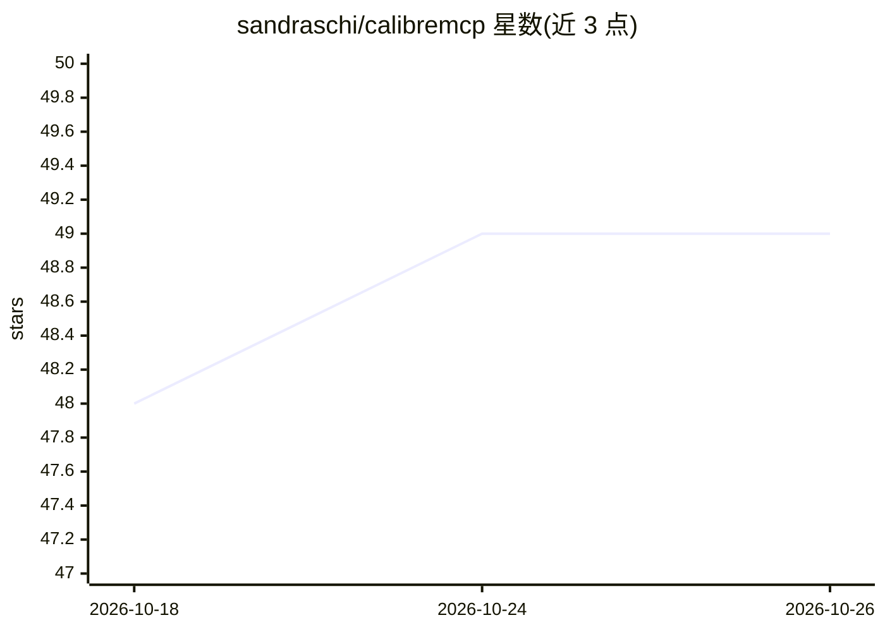

# sandraschi/calibremcp

⭐ 49 · Python · MIT · 推送 2026-10-25 · [GitHub](https://github.com/sandraschi/calibremcp) · 个人维护

**给 Calibre 电子书库的 FastMCP 服务器：AI 搜索、RAG 与库管理**

基于 FastMCP 3.2 的 MCP 服务器，直接读取 Calibre 的 metadata.db，将电子书库接入 Claude Desktop、Cursor 等 AI 助手。提供 33 个 MCP 工具做自然语言库管理，含 LanceDB 元数据语义 RAG、FTS5 全文检索、混排语义搜索（RRF）、Canon 缺口分析、库健康扫描、OCR 与重复书聚类。附带 Next.js 15 WebApp（AI 对话、智能导入，支持 Ollama/LM Studio/OpenAI）与 Tauri 桌面程序。Windows 原生发行 exe 安装包，开发者可从源码运行；默认仅本机回环访问，LAN 模式无鉴权，限可信网络。

## 筛选速览

| 维度 | 判定 | 备注 |
|---|---|---|
| AI 角色 | `ai-ecosystem` | LLM/agent 周边工具 |
| 许可风险 | `permissive` | MIT |
| 部署形态 | `desktop` | 安装包/桌面程序 |
| 模型依赖 | local-ok | 支持本地模型 |
| 硬件要求 | — | 无带数字的原话,不猜 |
| 安装摩擦 | `low` | 无编译、无系统依赖或容器化 |
| 成熟度 | — | 结构信号不足 |

## 能力要点

- 33 个 MCP 工具覆盖搜索、管理、导出、OCR、阅读器等操作
- LanceDB 元数据 RAG + FTS5 全文 chunk 检索，RRF 混排语义搜索
- Next.js WebApp 提供 AI 对话、智能导入、局域网/Tailscale 远程访问
- Windows 提供 x64 安装包，另有 Tauri 桌面程序与 Calibre GUI 插件

## 适用场景

- 通过 Claude Desktop 等助手用自然语言管理我的 Calibre 书库
- 对书库做语义搜索与全文内容检索
- 分析书库健康度、查重、对照经典书单找缺口

## 场景标签

`RAG` `语义搜索` `OCR` `知识库管理` · 领域:知识与检索

## 证据(README 行号)

> L14: **FastMCP 3.2 MCP server for Calibre e-book library management — AI-assisted search, RAG, and agentic workflows for
> L46: calibre-mcp bridges your Calibre e-book library and AI assistants (Claude Desktop, Cursor, etc.) via the Model Cont

## 星数曲线

2026-10-18 48 → 2026-10-26 49（+1）

---
*卡片 v1 · prompt 1.4 · 生成 2026-10-24 · 置信度 high · 依据 README sha `d524d07e649f` · [字段定义](../../DATASET.md)*
