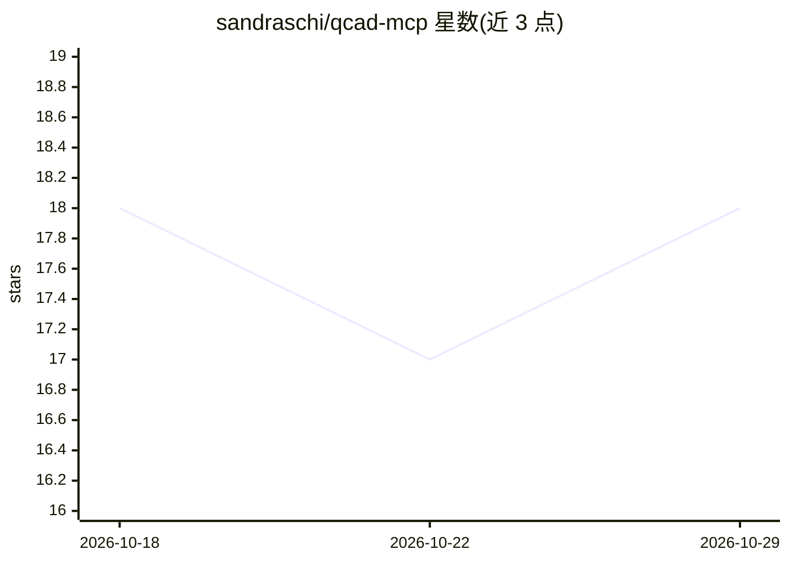

# sandraschi/qcad-mcp

⭐ 18 · Python · MIT · 推送 2026-10-24 · [GitHub](https://github.com/sandraschi/qcad-mcp) · 个人维护

**让 AI 助手操作 QCAD Pro 的 MCP 服务器与 Web 应用**

基于 FastMCP 3.4 的 CAD 自动化服务器：提供 12 个 MCP 工具，通过 ezdxf 解析/渲染/挤出/分析 DXF，经 QCAD Pro 转换 DWG、执行 ECMAScript 脚本，并含自然语言生成户型图、AutoLISP 转译、BIM/IFC 交接等操作。附带 22 页 TypeScript Web 应用（仪表盘、聊天、挤出、批处理等）、REST API 与持久化 DXF 文件库。面向希望在 Claude Desktop/Cursor 等客户端中以 AI 处理建筑图纸的开发者与用户；部分工具需另购 QCAD Pro（€50.40）。

## 筛选速览

| 维度 | 判定 | 备注 |
|---|---|---|
| AI 角色 | `ai-ecosystem` | LLM/agent 周边工具 |
| 许可风险 | `permissive` | MIT |
| 部署形态 | `None` |  |
| 模型依赖 | local-ok | 支持本地模型 |
| 硬件要求 | — | 无带数字的原话,不猜 |
| 安装摩擦 | `low` | 无编译、无系统依赖或容器化 |
| 成熟度 | — | 结构信号不足 |

## 能力要点

- 12 个 MCP 工具：DXF 解析、3D 挤出（STL/GLB）、图层/实体编辑、房间分析
- 自然语言生成户型图与自主多步 CAD 工作流
- 持久化 CAD 文件库（depot）与完整 REST CRUD API
- 含 22 页 Web 应用：聊天、演示、批处理挤出、Playground 等

## 适用场景

- 让 AI 助手批量处理建筑平面图并转换为 3D 模型
- 将 DXF 挤出为 STL 用于 Resonite/Unity3D
- 通过对话生成户型图并做房间面积与门窗分析

## 场景标签

`GUI 自动化` `代码生成` · 领域:效率与自动化

## 证据(README 行号)

> L9: **AI-driven 2D CAD automation — DXF/DWG parsing, 3D extrusion, persistent file depot, room analysis, and full CRUD m
> L194: - **Protocol**: FastMCP 3.4 (stdio + HTTP `/mcp`) + 40 REST routes

## 星数曲线

2026-10-18 18 → 2026-10-29 18（+0）

---
*卡片 v1 · prompt 1.4 · 生成 2026-10-29 · 置信度 high · 依据 README sha `1f15a3049588` · [字段定义](../../DATASET.md)*
