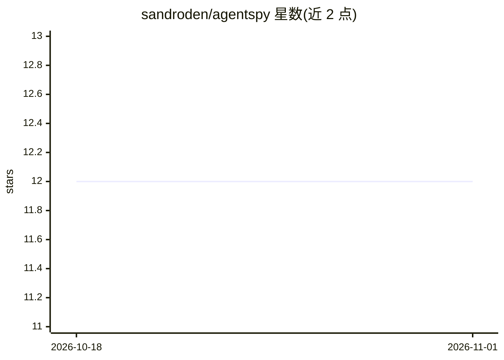

# sandroden/agentspy

⭐ 12 · Python · 推送 2026-10-02 · [GitHub](https://github.com/sandroden/agentspy) · 个人维护

**教学用工具：实时监控 Claude Code 与模型 API 的通信**

面向学习与调试的单进程观测工具：以 Starlette+uvicorn 起一个透明代理（ANTHROPIC_BASE_URL 指向它，转发至 api.anthropic.com），完整捕获每次请求与从 SSE 流重建的响应（含 usage、缓存、thinking、计时），并存入 SQLite，通过 WebSocket/REST 提供实时与回放 UI。另有三个可选观测通道：Claude Code hooks（会话/轮次/子代理生命周期）、MCP stdio 透明中继（JSON-RPC 监听）、以及 Codex/OpenAI Responses 捕获。提供 install.sh 与 claude-spy 一键安装脚本。定位为教学工具，存在已知限制文档。

## 筛选速览

| 维度 | 判定 | 备注 |
|---|---|---|
| AI 角色 | `ai-ecosystem` | LLM/agent 周边工具 |
| 许可风险 | `none` | — |
| 部署形态 | `None` |  |
| 模型依赖 | locked-api |  |
| 硬件要求 | — | 无带数字的原话,不猜 |
| 安装摩擦 | `low` | 无编译、无系统依赖或容器化 |
| 成熟度 | — | 结构信号不足 |

## 能力要点

- 透明代理捕获完整请求与 SSE 流重建的响应（usage/缓存/thinking/计时）
- 三个可选可组合通道：代理、hooks、MCP stdio 中继
- SQLite 存储配合 WebSocket 实时看板与 REST 回放 UI
- 支持 Anthropic 与经 OpenRouter 的 GLM 等多上游路由

## 适用场景

- 学习 Claude Code 如何组装 system prompt、工具与消息
- 调试子代理与 MCP 服务器的交互流程
- 观察并比对不同运行策略的 token/缓存用量

## 场景标签

`LLM 可观测性` · 领域:评测与运维

## 证据(README 行号)

> L3: An educational tool to **spy on and visualize in real time** the communication
> L22: A single process (`server/`, Starlette+uvicorn via uv) acts as a transparent
> L26: 1. **Proxy** (mandatory, the core): captures every complete round trip — the

## 星数曲线

2026-10-18 12 → 2026-11-01 12（+0）

---
*卡片 v1 · prompt 1.4 · 生成 2026-11-01 · 置信度 high · 依据 README sha `1b27fe5a2b75` · [字段定义](../../DATASET.md)*
