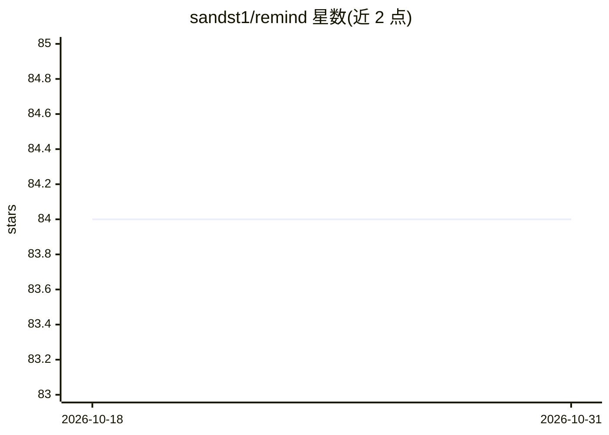

# sandst1/remind

⭐ 84 · Python · Apache-2.0 · 推送 2026-10-23 · [GitHub](https://github.com/sandst1/remind) · [官网](https://sandst1.github.io/remind/) · 个人维护

**面向 AI Agent 的本地长期记忆层（MCP/CLI）**

Remind 是给 LLM/Agent 用的确定性记忆基底：以 episode（原始经历）与 concept（泛化知识）两类记录存储记忆，提供时间性事实、语义检索（本地 fastembed 嵌入，默认无需 API key）、事实冲突检测与实体图。调用方 agent 负责智能，Remind 本身不做内部 LLM 调用。可通过 CLI、MCP Server（供 Cursor/Claude Desktop 等 IDE agent 接入）、Python API 与 REST 使用，支持 SQLite/PostgreSQL/MySQL 后端及 OpenAI 嵌入可选安装，并可安装 agent skills 教会 agent 使用方法。

## 筛选速览

| 维度 | 判定 | 备注 |
|---|---|---|
| AI 角色 | `ai-ecosystem` | LLM/agent 周边工具 |
| 许可风险 | `permissive` | Apache-2.0 |
| 部署形态 | `library` | 以包/库形式分发 |
| 模型依赖 | — | README 未给出锁定关系 |
| 硬件要求 | — | 无带数字的原话,不猜 |
| 安装摩擦 | `low` | 无编译、无系统依赖或容器化 |
| 成熟度 | — | 结构信号不足 |

## 能力要点

- 本地 fastembed 嵌入零配置默认运行，无需 API key
- 事实有效性追踪、冲突检测与 supersession 机制
- append-only 变更事件流（remind events --since）与事务性批量写（apply）
- MCP Server + Web UI + REST，支持 pgvector/sqlite-vec 向量索引

## 适用场景

- 为编码 Agent 提供跨会话的长期记忆与项目上下文
- 在 IDE agent（Cursor/Claude Desktop 等）中通过 MCP 记录与召回决策和事实
- 对 agent 记忆做策展：冲突处理、概念合并/拆分、事件轮询

## 场景标签

`Agent 记忆` · 领域:Agent 开发

## 证据(README 行号)

> L7: Agent-driven memory layer for LLMs. Remind is a deterministic memory substrate with temporal facts, semantic retriev
> L164: ## MCP Server

## 星数曲线

2026-10-18 84 → 2026-10-31 84（+0）

---
*卡片 v1 · prompt 1.4 · 生成 2026-10-24 · 置信度 high · 依据 README sha `623bf7b0db7b` · [字段定义](../../DATASET.md)*
