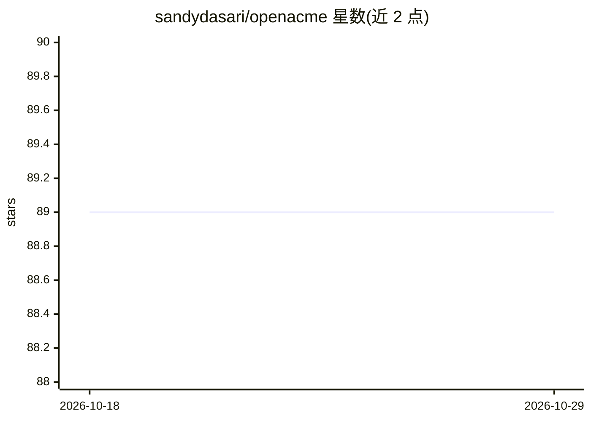

# sandydasari/openacme

⭐ 89 · TypeScript · MIT · 推送 2026-07-28 · [GitHub](https://github.com/sandydasari/openacme) · [官网](https://openacme.org) · 个人维护

**自托管多 agent AI 劳动力平台，带 Web 与 CLI 界面**

用 TypeScript 构建的开源、本地优先的多 agent 平台：以带角色、模型、工具与记忆的命名 agent 组成可自定组织结构的工作组，通过任务板与委托机制协作分解并执行目标。支持多模型接入（Anthropic/OpenAI/Google/OpenRouter/Ollama 及 OpenAI 兼容端点），MCP-native，可用 Claude 或 ChatGPT 订阅登录而非仅靠 API key。以守护进程形式本地运行，注册到 launchd/systemd-user，数据存于 ~/.openacme/ 下的 SQLite。需 Node ≥ 18，macOS/Linux。

## 筛选速览

| 维度 | 判定 | 备注 |
|---|---|---|
| AI 角色 | `ai-ecosystem` | LLM/agent 周边工具 |
| 许可风险 | `permissive` | MIT |
| 部署形态 | `library` | 以包/库形式分发 |
| 模型依赖 | local-ok | 支持本地模型 |
| 硬件要求 | — | 无带数字的原话,不猜 |
| 安装摩擦 | `low` | 无编译、无系统依赖或容器化 |
| 成熟度 | — | 结构信号不足 |

## 能力要点

- 扁平/管理者/专家团队等多种组织形态，agent 间通过内置 task_create 委托任务
- 每个 agent 是磁盘上的一个文件夹（AGENT.md + 工作区 + 私有记忆）
- 多 provider 接入，支持以 Claude Pro / ChatGPT Plus 订阅登录驱动
- 本地守护进程 + Web UI / CLI，任务板与事件日志存于 SQLite

## 适用场景

- 搭建按角色分工、可自主委托的 AI agent 团队处理日常工作
- 设定周期任务让 agent 定时执行（如内容排期、竞品周报）
- 在本地长期运行 agent 并保留跨会话记忆

## 场景标签

`Agent 框架` `多智能体` `Agent 记忆` · 领域:Agent 开发

## 证据(README 行号)

> L7: OpenAcme is an open-source, local-first, self-hosted **multi-agent AI platform** — a practical alternative to CrewAI
> L30: The substrate is the same in every shape. Agents share a task board, any agent can assign work to any other (`task_

## 星数曲线

2026-10-18 89 → 2026-10-29 89（+0）

---
*卡片 v1 · prompt 1.4 · 生成 2026-10-23 · 置信度 high · 依据 README sha `f2cf1fd6b431` · [字段定义](../../DATASET.md)*
