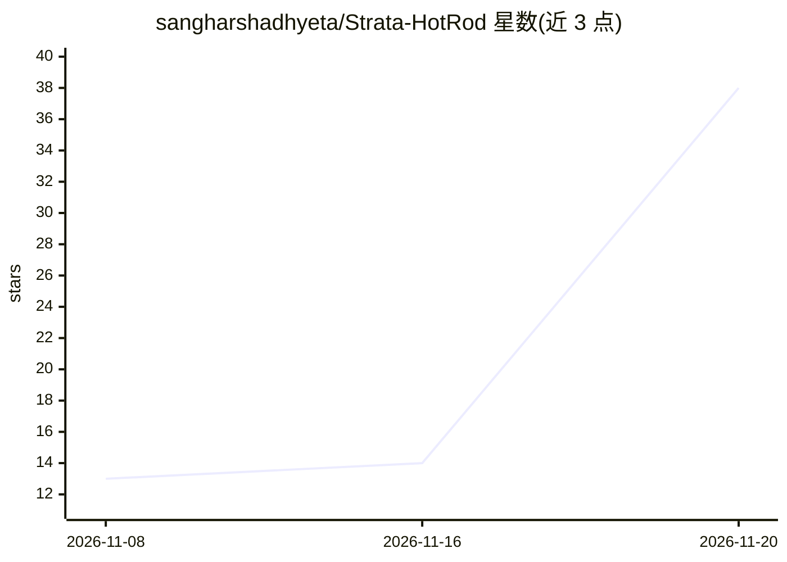

# sangharshadhyeta/Strata-HotRod

⭐ 38 · C++ · MIT · 推送 2026-11-19 · [GitHub](https://github.com/sangharshadhyeta/Strata-HotRod) · [官网](https://sangharshadhyeta.github.io/Strata-HotRod/) · 个人维护

**在单张游戏显卡上本地运行 125B MoE 模型的推理引擎分支**

Strata 的 fork，面向低配硬件用户：把 Qwen3.8-Flash-Next（125B，78-111 GB 量化文件）的三层专家分层放置于显卡、RAM 与 SSD，配合预读学习与替身专家机制，在 RTX 3060 12 GB + 30 GB RAM 的机器上以 50-70 tokens/s（IQ3_S）运行，上下文达 262K，全程离线。另设分支支持 DeepSeek-V4.1-Flash 与 Edge0-145B。README 声明仅在单台机器、单一模型上测过，其他显卡/系统未验证。

## 筛选速览

| 维度 | 判定 | 备注 |
|---|---|---|
| AI 角色 | `ai-ecosystem` | LLM/agent 周边工具 |
| 许可风险 | `permissive` | MIT |
| 部署形态 | `desktop` | 安装包/桌面程序 |
| 模型依赖 | — | README 未给出锁定关系 |
| 硬件要求 | `gpu-8g` | |
| 安装摩擦 | `high` | 编译与系统依赖俱全 |
| 成熟度 | `idea` | |

## 能力要点

- 三层专家存储：显卡→RAM→SSD，30 GB RAM 运行 78-111 GB 模型
- 学习式预读：提前 1/2/4 层猜测所需专家（85/78/71% 命中）
- 替身专家 + flip re-check 可选精确复算
- 262K 上下文，45K 会话次轮 0.4s 恢复

## 适用场景

- 在 12 GB 显存的家用显卡上本地运行 125B MoE 模型
- 低 RAM、大模型的完全离线推理
- 长上下文（262K）本地对话与代码生成

## 场景标签

`推理引擎` · 领域:训练与推理

## 证据(README 行号)

> L58: **Yes.** On one RTX 3060 12 GB with 30 GB of RAM and an NVMe SSD, this fork runs Qwen3.8-Flash-Next (Qwen 3.8 Flash
> L123: The model has 512 experts per layer and picks 10 for every token; only some fit on the card. Everything this fork 
> L35: A fork of Strata by Niko1221 and contributors (MIT). Strata keeps Qwen's experts in

## 星数曲线

2026-11-08 13 → 2026-11-20 38（+25）

---
*卡片 v1 · prompt 1.4 · 生成 2026-11-18 · 置信度 high · 依据 README sha `12092c78419f` · [字段定义](../../DATASET.md)*
