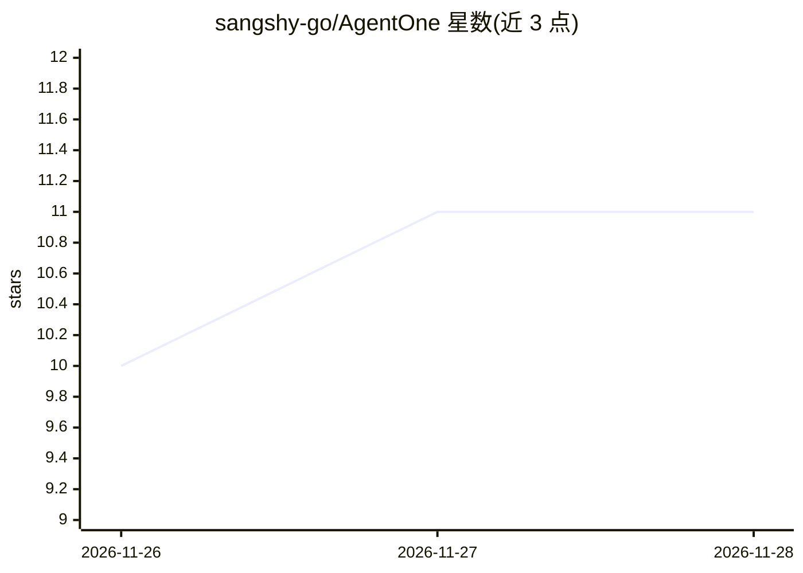

# sangshy-go/AgentOne

⭐ 11 · Java · MIT · 推送 2026-09-01 · [GitHub](https://github.com/sangshy-go/AgentOne) · 组织维护 · 中文 README

**企业私有部署 AI Agent 中台：模型接入/RAG/Agent 一站式搭建**

基于 Java 17 + Spring Boot + Vue 3 的 AI Agent 中台，将模型接入、知识库 RAG（Tika 解析 + PgVector 检索）、ReAct Agent 编排、Skill 生态、MCP 集成、钉钉机器人接入、开放 API 封装为带管理后台的产品。定位银行/保险/国企等合规行业，主打全私有部署、数据不出域、多租户隔离、RBAC 四角色、对话留痕与 Agent 发布双人审批。`docker compose up` 一键拉起全部组件；README 未提供托管版，全部自建。

## 筛选速览

| 维度 | 判定 | 备注 |
|---|---|---|
| AI 角色 | `ai-ecosystem` | LLM/agent 周边工具 |
| 许可风险 | `permissive` | MIT |
| 部署形态 | `self-host` | docker 或自建部署 |
| 模型依赖 | local-ok | 支持本地模型 |
| 硬件要求 | — | 无带数字的原话,不猜 |
| 安装摩擦 | `low` | 无编译、无系统依赖或容器化 |
| 成熟度 | — | 结构信号不足 |

## 能力要点

- ReAct Agent 引擎（基于 AgentScope），SSE 流式对话与工具调用可视化
- 知识库 RAG：文档解析、分块、向量化、PgVector 相似度检索
- 兼容 OpenAI 协议的多模型接入 + MCP 三种传输 + 钉钉机器人网关
- 多租户隔离、RBAC 四角色、审计留痕与发布双人审批

## 适用场景

- 为银行/保险等团队搭建数据不出域的私有 AI 助手
- 不写代码在页面上配置 Agent 并通过 API 接入业务系统
- 上传企业文档建知识库做问答
- 通过钉钉机器人给团队提供 AI 对话入口

## 场景标签

`AI 助手` `RAG` `聊天机器人` · 领域:对话与助手

## 证据(README 行号)

> L26: AgentOne 是一个**开箱即用的 AI Agent 中台**。它把构建 AI 助手所需的模型接入、知识库 RAG、Agent 编排、Skill 生态、MCP 集成、IM 接入、流式对话、多租户隔离和开放 API 等能力，封装
> L44: |🔌 **多模型管理**|模型供应商与模型两层结构，兼容所有 OpenAI 协议服务（DashScope、DeepSeek、Ollama…）；Chat / Embedding 模型按工作空间配置；一键连通性检测|
> L52: |🐳 **一键部署**|根目录 `docker compose up` 同时拉起 PostgreSQL、Redis、后端、前端；Flyway 自动建表迁移|

## 星数曲线

2026-11-26 10 → 2026-11-28 11（+1）

---
*卡片 v1 · prompt 1.4 · 生成 2026-11-26 · 置信度 mid · 依据 README sha `929bfd34a537` · [字段定义](../../DATASET.md)*
