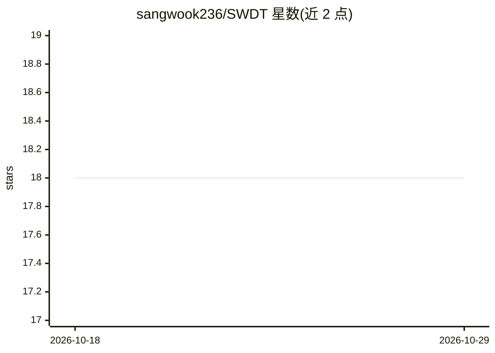

# sangwook236/SWDT

⭐ 18 · C++ · GPL-3.0 · 推送 2026-10-27 · [GitHub](https://github.com/sangwook236/SWDT) · 个人维护

**个人积累的软硬件开发与测试知识仓库（代码+Wiki）**

以系统化积累软件开发与测试中获得的源码、知识与经验为目标的个人仓库。内容覆盖多种编程语言（C/C++、C#、Python、Java、Matlab、R 等）与硬件组件（Kinect 图像传感器、AHRS/IMU/GPS、Arduino、树莓派、STM32 等 ARM/AVR/ESP32 微处理器），并附资源列表与 Wiki，收录构思、概念化与数学建模等研发资料。以 GitHub 仓库与 Wiki 形式提供，无独立安装运行方式。

## 筛选速览

| 维度 | 判定 | 备注 |
|---|---|---|
| AI 角色 | `ai-knowledge` | 知识聚合/清单类 |
| 许可风险 | `viral` | GPL-3.0 |
| 部署形态 | `None` |  |
| 模型依赖 | — | README 未给出锁定关系 |
| 硬件要求 | — | 无带数字的原话,不猜 |
| 安装摩擦 | `low` | 无编译、无系统依赖或容器化 |
| 成熟度 | — | 结构信号不足 |

## 能力要点

- 覆盖多语言软件与多类硬件（传感器、开源硬件、微处理器）的代码与知识积累
- 附 S/W 工程、计算机系统、计算机图形学等资源分类
- 提供 Wiki 收录构思、概念化与数学建模等研发资料

## 适用场景

- 查阅软硬件开发与测试的经验与代码片段
- 了解传感器与嵌入式硬件相关的开发资料
- 浏览研发过程从想法到数学建模的参考资源

## 场景标签

 · 领域:软件开发/嵌入式与机器人

## 证据(README 行号)

> L9: The goal of SWDT is to systematically accumulate source codes, knowledge, and experience acquired in the development
> L34: A repository of resources for research and development of S/W and H/W including ideation, conceptualization, and ma

## 星数曲线

2026-10-18 18 → 2026-10-29 18（+0）

---
*卡片 v1 · prompt 1.4 · 生成 2026-10-29 · 置信度 mid · 依据 README sha `9d4d3edbd9b4` · [字段定义](../../DATASET.md)*
