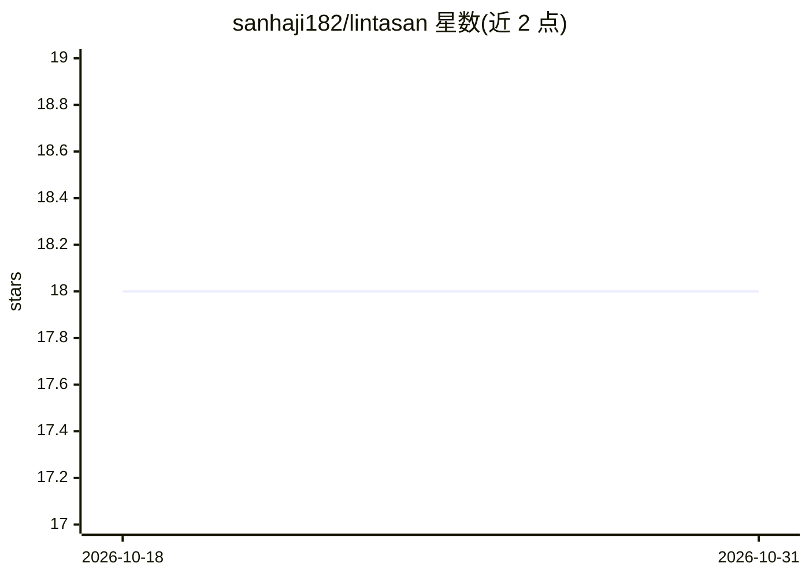

# sanhaji182/lintasan

⭐ 18 · Go · MIT · 推送 2026-10-29 · [GitHub](https://github.com/sanhaji182/lintasan) · [官网](https://sanhaji182.github.io/lintasan/) · 个人维护

**Go 编写的自托管 LLM 网关：单一 OpenAI 兼容端点接入多家 AI 提供商**

面向需要统一接入多个 LLM 提供商的用户：以一个 OpenAI 兼容端点代理 OpenAI、Anthropic、DeepSeek、Gemini、Groq 等，提供智能路由、连接池负载均衡、多级回退、熔断器、语义缓存、令牌压缩、费用追踪与 25 页实时监控仪表盘。形态为约 26MB 的 Go 单二进制（内嵌 SvelteKit SPA 与 SQLite，零配置），含 MCP 服务器与 CLI。另带实验性 Qoder 端口（默认关闭，需显式开启）。README 提供与旧 Node.js 版本的内存/体积/吞吐对比数据。

## 筛选速览

| 维度 | 判定 | 备注 |
|---|---|---|
| AI 角色 | `ai-ecosystem` | LLM/agent 周边工具 |
| 许可风险 | `permissive` | MIT |
| 部署形态 | `self-host` | docker 或自建部署 |
| 模型依赖 | local-ok | 支持本地模型 |
| 硬件要求 | — | 无带数字的原话,不猜 |
| 安装摩擦 | `low` | 无编译、无系统依赖或容器化 |
| 成熟度 | `idea` | |

## 能力要点

- 单一 OpenAI 兼容端点统一接入多提供商，集中 API key 管理
- 多阶段智能路由、连接池负载均衡、多级回退与熔断器
- 约 26MB 单二进制，内嵌 SQLite 与 SvelteKit 仪表盘，零配置
- MCP 服务器（14+ 工具）、语义缓存、费用追踪、AES-256-GCM 凭证存储

## 适用场景

- 自建 LLM API 网关，统一管理多家提供商的密钥与路由
- 为生产应用提供故障转移与负载均衡的模型访问层
- 监控各模型/提供商的 token 用量、延迟与成本

## 场景标签

`模型网关` · 领域:Agent 开发

## 证据(README 行号)

> L45: Lintasan adalah **LLM gateway** — satu endpoint OpenAI-compatible untuk semua provider AI. Routing cerdas, failover
> L64: Lintasan is an **LLM gateway** — one OpenAI-compatible endpoint for all AI providers. Smart routing, automatic fail
> L169: |1|**Multi-Provider Gateway**|One OpenAI-compatible endpoint for all LLM providers|

## 星数曲线

2026-10-18 18 → 2026-10-31 18（+0）

---
*卡片 v1 · prompt 1.4 · 生成 2026-10-29 · 置信度 mid · 依据 README sha `2031a8c0147f` · [字段定义](../../DATASET.md)*
