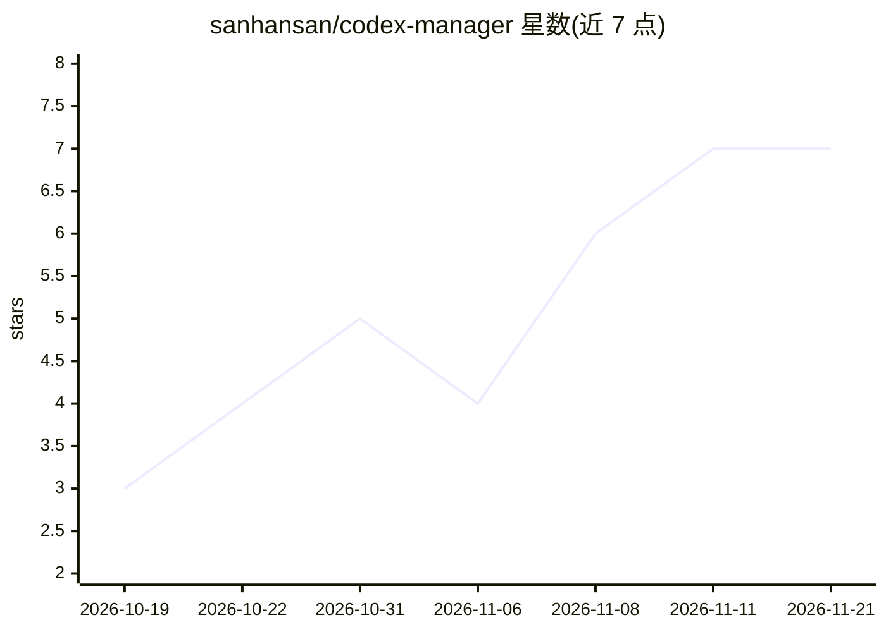

# sanhansan/codex-manager

⭐ — · [GitHub]() · 个人维护 · 中文 README

**给 Codex 类 AI 编码工作台做会话用量看板与流程可视化的插件**

运行于 ZCode 插件生态的单文件编辑器加本地服务（flow_serve.py），通过后台静默钩子采集 Codex 风格编码 agent 工作台的插件使用情况与会话过程，回答'装了哪些插件真正在用'与'AI 如何一步步完成任务'两个问题。核心输出包括 Token 用量看板、问答追踪、SVG 流程画布（支持逻辑门/决策块/正交连线）、分布式工作区与按项目→agent→会话→轮次四层组织的神经网络文字树图。发布页提供打包好的 Release 供直接下载。

## 筛选速览

| 维度 | 判定 | 备注 |
|---|---|---|
| AI 角色 | `ai-ecosystem` | LLM/agent 周边工具 |
| 许可风险 | `none` | — |
| 部署形态 | `desktop` | 安装包/桌面程序 |
| 模型依赖 | — | README 未给出锁定关系 |
| 硬件要求 | — | 无带数字的原话,不猜 |
| 安装摩擦 | `low` | 无编译、无系统依赖或容器化 |
| 成熟度 | — | 结构信号不足 |

## 能力要点

- 后台静默钩子采集插件使用与会话流程，一条命令出结果
- SVG 流程画布：逻辑门、决策分支、正交避障布线、跳转高亮
- 神经网络文字树图：project→agent→session→turn 四层嵌套
- 分布式工作区卡片可一键导入会话到神经网络视图（上限 60）

## 适用场景

- 查看我装的插件里哪些真正被用到
- 把每次 AI 会话生成流程图用于复盘和改进
- 按 Token 用量评估每次改动是否有效

## 场景标签

`LLM 可观测性` · 领域:评测与运维

## 证据(README 行号)

> L3: Plugin usage tracking & session flowcharts for Codex workbenches.
> L11: This plugin targets Codex-style AI coding agent workbenches (built on the ZCode plugin ecosystem) and answers two q

## 星数曲线

2026-10-19 3 → 2026-11-21 7（+4）

---
*卡片 v1 · prompt 1.4 · 生成 2026-11-20 · 置信度 mid · 依据 README sha `e2be5c5dbd83` · [字段定义](../../DATASET.md)*
