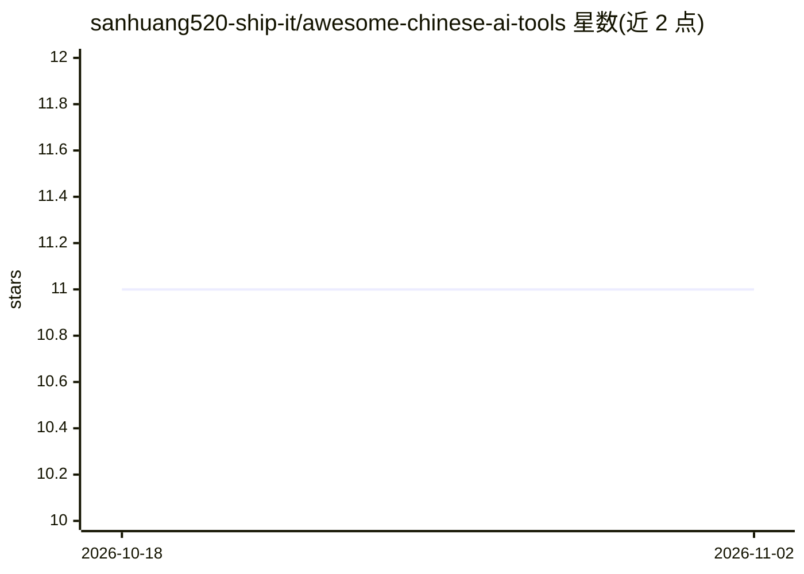

# sanhuang520-ship-it/awesome-chinese-ai-tools

⭐ 11 · HTML · MIT · 推送 2026-10-26 · [GitHub](https://github.com/sanhuang520-ship-it/awesome-chinese-ai-tools) · [官网](https://sanhuang520-ship-it.github.io/awesome-chinese-ai-tools/) · 个人维护 · 中文 README

**中文 Agent Skills 合集：212 条目、13 个原创、带可复现实测证据**

中文 Agent Skills 聚合目录：收录 212 个 Skill 条目（85 个中文、19 个官方、13 个本站原创），来源为 164 个仓库，GitHub Actions 每周自动复检来源仓库存活性并重建清单。13 个原创 Skill 覆盖中文排版、周报、教案、电商文案、国风渲染等，每个声明「不做什么」边界。兼容性证据以分层实测记录：13 个在 Codex 任务级实测自动触发，Claude Code/Cursor 仅有安装核验或待测。通过 npx skills CLI 安装，附只读安装前安全审计器与结构化反馈表单。

## 筛选速览

| 维度 | 判定 | 备注 |
|---|---|---|
| AI 角色 | `ai-knowledge` | 知识聚合/清单类 |
| 许可风险 | `permissive` | MIT |
| 部署形态 | `library` | 以包/库形式分发 |
| 模型依赖 | — | README 未给出锁定关系 |
| 硬件要求 | — | 无带数字的原话,不猜 |
| 安装摩擦 | `low` | 无编译、无系统依赖或容器化 |
| 成熟度 | — | 结构信号不足 |

## 能力要点

- 212 个 Skill 条目来自 164 个仓库，每周自动复检存活性
- 13 个本站原创 Skill，Codex 13/13 自动触发实测且失败记录公开保留
- 兼容性四层测试法：发现/安装/自动触发/任务完成分别记录
- 只读安装前审计器：检查脚本、符号链接、联网、凭据词与高风险命令

## 适用场景

- 为 Codex/Claude Code/Cursor 等客户端查找中文场景的 Agent Skill
- 直接安装中文排版、周报、教案等开箱即用的中文 Skill
- 查阅各客户端的 Skill 兼容性实测证据再决定选型
- 按官方公告页直达链接追踪 AI 工具动态

## 场景标签

`精选清单` `提示工程` · 领域:Agent 开发

## 证据(README 行号)

> L7:  中文 Agent Skills 合集：可搜索、可安装、带实测证据 · Chinese Agent Skills / Chinese AI Skills directory with reproducible Codex evide
> L208: |分类|数量|
> L210: |🇨🇳 中文 Skill 条目|85|

## 星数曲线

2026-10-18 11 → 2026-11-02 11（+0）

---
*卡片 v1 · prompt 1.4 · 生成 2026-11-01 · 置信度 mid · 依据 README sha `f2aaed535998` · [字段定义](../../DATASET.md)*
