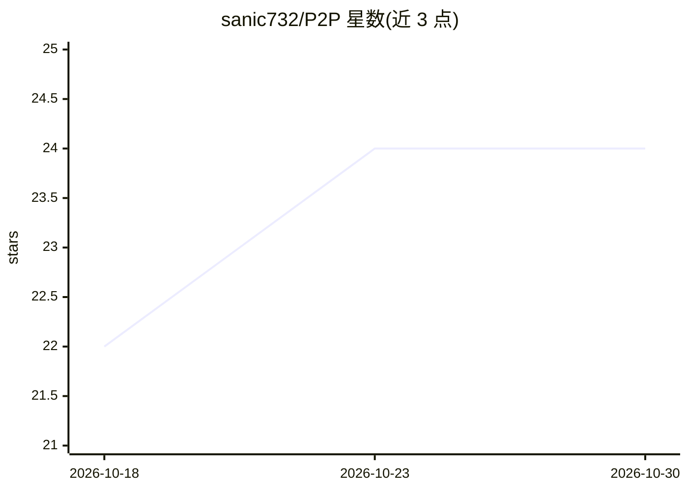

# sanic732/P2P

⭐ 24 · MIT · 推送 2026-10-14 · [GitHub](https://github.com/sanic732/P2P) · [官网](https://sanic732.github.io/P2P/) · 个人维护

**为使用者的任务生成适配目标模型语法的提示词的 Claude 插件**

P2P 是以纯文本 Markdown 组织的提示词生成系统，以 Claude 插件形式分发（Claude Code、Cowork、claude.ai），并在每个 release 附带供 Gemini、GPT、Qwen 等其他模型使用的文件版。用户用自然语言描述任务，P2P 按目标模型家族的语法（Claude 用 XML、Gemini 用 Markdown、Grok 用 JSON）产出可用的提示词；内部按层级组织（索引、核心、知识库、厂商、按需模块），困难任务可召集最多八个专家角色的 QUORUM 议会。无脚本、无网络调用、不收集数据。

## 筛选速览

| 维度 | 判定 | 备注 |
|---|---|---|
| AI 角色 | `ai-native` | 本体是模型或模型工具 |
| 许可风险 | `permissive` | MIT |
| 部署形态 | `None` |  |
| 模型依赖 | locked-api |  |
| 硬件要求 | — | 无带数字的原话,不猜 |
| 安装摩擦 | `low` | 无编译、无系统依赖或容器化 |
| 成熟度 | — | 结构信号不足 |

## 能力要点

- 按目标模型家族语法生成提示词（XML/Markdown/JSON 各归其位）
- 层级化纯文本结构，模块按需加载（RAG、推理链、路由、安全审计等）
- QUORUM 可召集最多八个专家角色，在 Claude Code/Cowork 中作为子代理运行
- 每个 release 附带供其他模型使用的文件版（P2P_9.0.0-M_en.zip）

## 适用场景

- 用日常语言描述任务，获得适配 Claude/Gemini/GPT 等模型的即用提示词
- 审计或重构已有的长篇提示词
- 通过 API 多模型场景下附加 live_specs.md 获取模型 id、价格与上下文窗口数据

## 场景标签

`提示工程` `多智能体` · 领域:Agent 开发

## 证据(README 行号)

> L5: **A prompt that writes prompts.** Describe your task in your own words — P2P builds one precise, ready prompt for it
> L7: P2P 9 ships as a **Claude plugin** (Claude Code, Cowork, claude.ai). A file edition for other models (Gemini, GPT, Q
> L58: P2P is plain text: Markdown files you can open and read. **No scripts, no hooks, no network calls, nothing collecte

## 星数曲线

2026-10-18 22 → 2026-10-30 24（+2）

---
*卡片 v1 · prompt 1.4 · 生成 2026-10-27 · 置信度 high · 依据 README sha `b430980b9339` · [字段定义](../../DATASET.md)*
