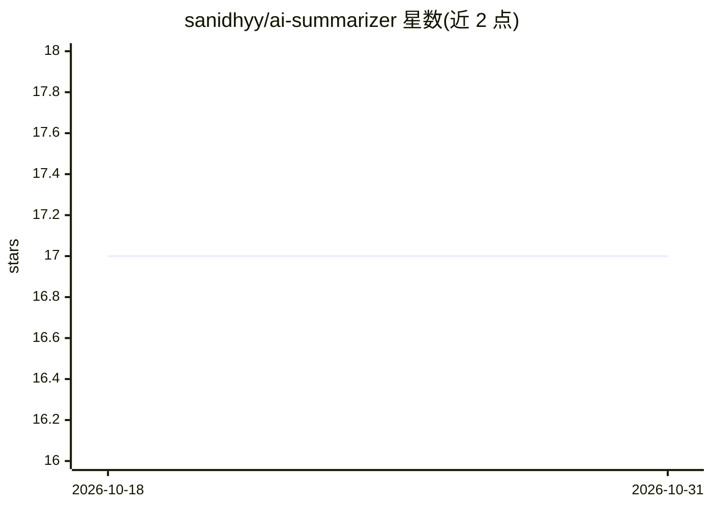

# sanidhyy/ai-summarizer

⭐ 17 · JavaScript · MIT · 推送 2026-10-27 · [GitHub](https://github.com/sanidhyy/ai-summarizer) · [官网](https://summise.netlify.app/) · 个人维护

**基于 GPT-4 的网页文章摘要生成 Web 应用**

名为 Summise 的 React Web 应用：用户输入文章后经 RapidAPI 上的 Article Extractor and Summarizer API（GPT-4）生成文章摘要，前端使用 React、Tailwind CSS、Vite 构建，通过 Netlify CLI 运行并依赖 Netlify Function。安装需克隆仓库、在 .env 配置 RapidAPI 密钥、npm/pnpm install 后 npm run dev 启动。摘要功能依赖第三方 API key，仅 UI 开发可用 pnpm vite 绕开。

## 筛选速览

| 维度 | 判定 | 备注 |
|---|---|---|
| AI 角色 | `ai-native` | 本体是模型或模型工具 |
| 许可风险 | `permissive` | MIT |
| 部署形态 | `library` | 以包/库形式分发 |
| 模型依赖 | — | README 未给出锁定关系 |
| 硬件要求 | — | 无带数字的原话,不猜 |
| 安装摩擦 | `low` | 无编译、无系统依赖或容器化 |
| 成熟度 | — | 结构信号不足 |

## 能力要点

- 调用 RapidAPI 的 Article Extractor and Summarizer API（GPT-4）生成摘要
- React + Tailwind CSS + Vite 前端，Netlify CLI 运行
- 提供 pnpm dev/vite/test/build 等脚本

## 适用场景

- 粘贴文章链接快速获得摘要
- 作为 React + API 集成的学习示例项目

## 场景标签

`AI 写作` · 领域:内容生成

## 证据(README 行号)

> L3: Modern OpenAI GPT-4 Article Summarizer
> L27: 6. Enable this API: API: Article Extractor and Summarizer by Anthony.
> L53: Chat GPT-4 AI Model

## 星数曲线

2026-10-18 17 → 2026-10-31 17（+0）

---
*卡片 v1 · prompt 1.4 · 生成 2026-10-29 · 置信度 mid · 依据 README sha `45994839ecbc` · [字段定义](../../DATASET.md)*
