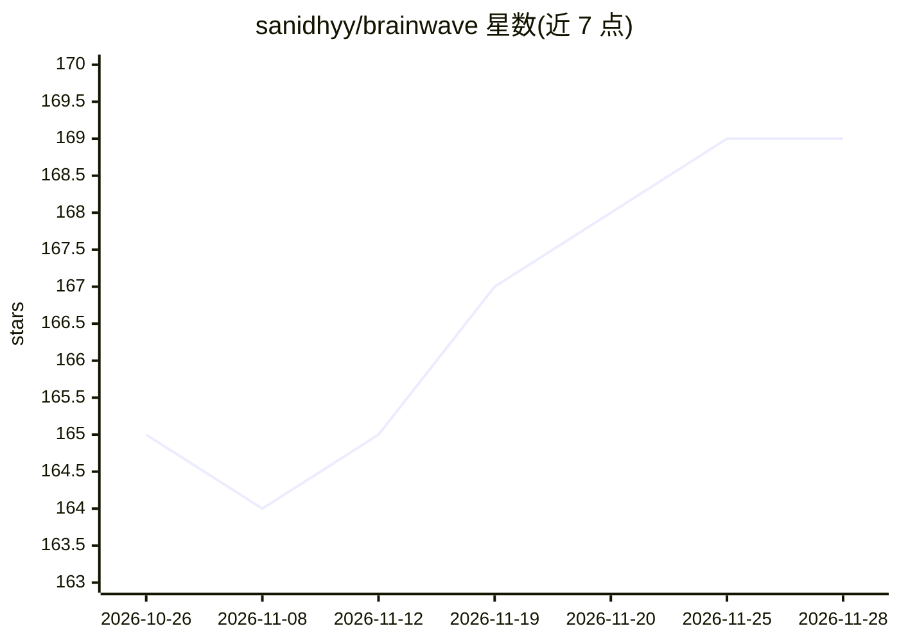

# sanidhyy/brainwave

⭐ 169 · JavaScript · MIT · 推送 2026-11-18 · [GitHub](https://github.com/sanidhyy/brainwave) · [官网](https://app-brainwave.netlify.app/) · 个人维护

**生成式 AI 主题的动画 SaaS 落地页前端模板**

一个以生成式 AI 产品为主题的动画落地页模板，基于 React + Vite 构建，使用 Tailwind CSS、framer-motion、react-just-parallax 等实现动画与视差效果，页面包含 AI 聊天机器人应用展示、Onboarding 区块等分区，可部署到 Netlify。安装需 NodeJS 与 Git，通过 npm/yarn 安装依赖后以 dev 模式运行。README 未描述任何后端模型调用实现，仅提示保管 API keys 配置。

## 筛选速览

| 维度 | 判定 | 备注 |
|---|---|---|
| AI 角色 | `ai-enhanced` | 去掉 AI 部分产品仍成立 |
| 许可风险 | `permissive` | MIT |
| 部署形态 | `library` | 以包/库形式分发 |
| 模型依赖 | — | README 未给出锁定关系 |
| 硬件要求 | — | 无带数字的原话,不猜 |
| 安装摩擦 | `low` | 无编译、无系统依赖或容器化 |
| 成熟度 | — | 结构信号不足 |

## 能力要点

- React + Vite + Tailwind CSS 技术栈的前端项目
- framer-motion 与 react-just-parallax 实现动画与视差效果
- 提供 Netlify 部署指引
- npm/yarn 安装依赖后本地运行

## 适用场景

- 为生成式 AI 产品搭建展示落地页
- 学习 React 动画页面的实现方式
- 部署到 Netlify 作为产品宣传站点

## 场景标签

 · 领域:Web 前端/营销落地页

## 证据(README 行号)

> L1: # Brainwave - Modern Animated SaaS Generative AI Landing Page
> L56: ## :gear: Tech Stack
> L58: React JS Vite JS Javascript Tailwind CSS Netlify

## 星数曲线

2026-10-26 165 → 2026-11-28 169（+4）

---
*卡片 v1 · prompt 1.4 · 生成 2026-11-26 · 置信度 mid · 依据 README sha `6a11f6523e38` · [字段定义](../../DATASET.md)*
