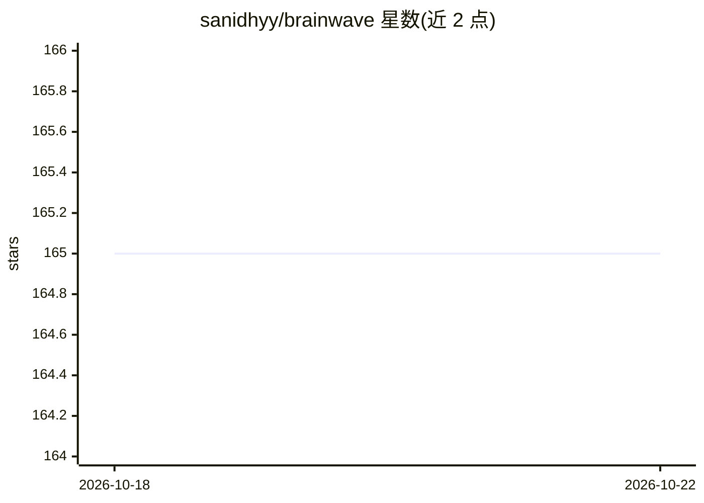

# sanidhyy/brainwave

⭐ 165 · JavaScript · MIT · 推送 2026-10-19 · [GitHub](https://github.com/sanidhyy/brainwave) · [官网](https://app-brainwave.netlify.app/) · 个人维护

**React 实现的生成式 AI SaaS 落地页模板**

基于 React JS、Vite、Tailwind CSS、Framer Motion 的 SaaS 生成式 AI 主题落地页模板，含 AI 聊天界面、Onboarding 等区块与动画效果。面向需要此类落地页的前端开发者，通过 Git 克隆仓库并 npm install 安装依赖后以 npm run dev 运行，可部署到 Netlify。README 提示保管 API keys，但未给出具体的 AI 服务接入说明。

## 筛选速览

| 维度 | 判定 | 备注 |
|---|---|---|
| AI 角色 | `ai-enhanced` | 去掉 AI 部分产品仍成立 |
| 许可风险 | `permissive` | MIT |
| 部署形态 | `library` | 以包/库形式分发 |
| 模型依赖 | — | README 未给出锁定关系 |
| 硬件要求 | — | 无带数字的原话,不猜 |
| 安装摩擦 | `low` | 无编译、无系统依赖或容器化 |
| 成熟度 | — | 结构信号不足 |

## 能力要点

- React + Vite + Tailwind CSS + Framer Motion 技术栈
- AI 聊天界面与 Onboarding 等展示区块
- 提供 Netlify 部署指引

## 适用场景

- 快速搭建 AI SaaS 产品宣传落地页
- 学习 React 动效落地页的实现结构

## 场景标签

 · 领域:前端/落地页模板

## 证据(README 行号)

> L1: # Brainwave - Modern Animated SaaS Generative AI Landing Page
> L56: ## :gear: Tech Stack
> L58: React JS Vite JS Javascript Tailwind CSS Netlify

## 星数曲线

2026-10-18 165 → 2026-10-22 165（+0）

---
*卡片 v1 · prompt 1.4 · 生成 2026-10-22 · 置信度 high · 依据 README sha `d2c48af9bb04` · [字段定义](../../DATASET.md)*
