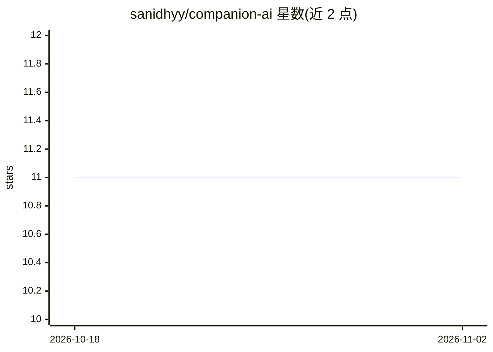

# sanidhyy/companion-ai

⭐ 11 · TypeScript · MIT · 推送 2026-10-22 · [GitHub](https://github.com/sanidhyy/companion-ai) · [官网](https://aicompanion.netlify.app/) · 个人维护

**Next.js SaaS 平台：创建并对话 AI 陪伴角色**

基于 Next.js 16 的 AI 陪伴角色 SaaS Web 应用：用户创建自定义 companion（按类别组织）、与其对话，含 Pro 订阅付费（Stripe）。集成 Clerk 认证、Pinecone 向量检索（经 LangChain）、Upstash Redis 限流、Aiven MySQL 存储、Cloudinary 图片上传；用户的 OpenAI/Pinecone 凭据经加密 httpOnly cookie 存储。面向想在本地部署或二次开发的开发者，配置需注册多项第三方服务并填写 .env。

## 筛选速览

| 维度 | 判定 | 备注 |
|---|---|---|
| AI 角色 | `ai-native` | 本体是模型或模型工具 |
| 许可风险 | `permissive` | MIT |
| 部署形态 | `library` | 以包/库形式分发 |
| 模型依赖 | — | README 未给出锁定关系 |
| 硬件要求 | — | 无带数字的原话,不猜 |
| 安装摩擦 | `low` | 无编译、无系统依赖或容器化 |
| 成熟度 | — | 结构信号不足 |

## 能力要点

- 创建与对话自定义 AI 陪伴角色，按类别组织
- Stripe Pro 订阅付费流程
- Pinecone + LangChain 检索、Clerk 认证、Upstash 限流等集成
- 提供分类与角色的数据库种子脚本

## 适用场景

- 部署一个可创建 AI 陪伴角色并对话的 SaaS 网站
- 学习 Next.js 全栈 + 多服务集成的实现
- 作为陪伴类对话产品二次开发的基础

## 场景标签

`聊天机器人` · 领域:对话与助手

## 证据(README 行号)

> L1: # Companion.ai - A Modern Next.js 16 SaaS Companion AI Platform.
> L145: Chat with Companions

## 星数曲线

2026-10-18 11 → 2026-11-02 11（+0）

---
*卡片 v1 · prompt 1.4 · 生成 2026-11-01 · 置信度 high · 依据 README sha `dd6f84445d72` · [字段定义](../../DATASET.md)*
