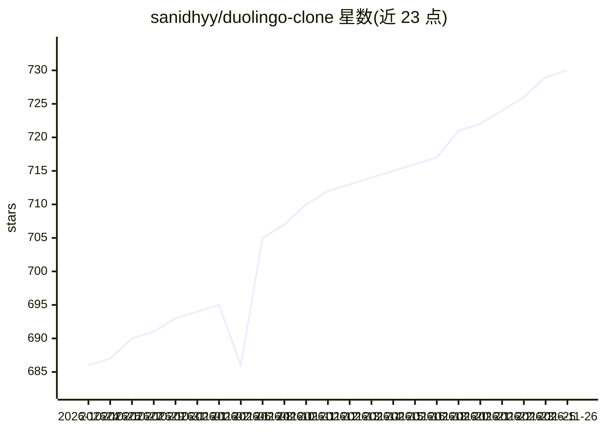

# sanidhyy/duolingo-clone

⭐ 730 · TypeScript · MIT · 推送 2026-11-19 · [GitHub](https://github.com/sanidhyy/duolingo-clone) · [官网](https://lingo-clone.vercel.app) · 个人维护

**开发者用的语言学习平台克隆项目（Next.js 全栈模板）**

基于 React/Next.js/TypeScript 的语言学习 Web 应用，含挑战进度、任务（Quests）、商店等界面截图展示。数据层使用 Drizzle ORM 连接 Neon PostgreSQL，身份认证依赖 Clerk，支付集成 Stripe，提供管理后台（react-admin）。README 给出完整部署流程：配置 .env.local 密钥（Clerk/Neon/Stripe）、pnpm 安装依赖、执行种子脚本写入课程数据，支持 Vercel 部署。技术栈致谢中列出 Elevenlabs AI。

## 筛选速览

| 维度 | 判定 | 备注 |
|---|---|---|
| AI 角色 | `ai-enhanced` | 去掉 AI 部分产品仍成立 |
| 许可风险 | `permissive` | MIT |
| 部署形态 | `library` | 以包/库形式分发 |
| 模型依赖 | — | README 未给出锁定关系 |
| 硬件要求 | — | 无带数字的原话,不猜 |
| 安装摩擦 | `low` | 无编译、无系统依赖或容器化 |
| 成熟度 | — | 结构信号不足 |

## 能力要点

- Next.js + TypeScript + Tailwind CSS 全栈实现
- Drizzle ORM + Neon PostgreSQL 数据持久化与种子脚本
- Clerk 认证与 Stripe 支付/ webhook 集成
- 提供 Vercel 部署路径与 react-admin 管理后台依赖

## 适用场景

- 作为语言学习类 Web 应用的开发起点模板
- 学习 Next.js + Drizzle + Clerk + Stripe 的全栈集成方式
- 部署一个包含课程进度、商店、任务系统的学习平台

## 场景标签

 · 领域:教育/语言学习

## 证据(README 行号)

> L120: React JS Next JS Typescript Tailwind CSS Vercel Postgresql
> L137: - Elevenlabs AI: https://elevenlabs.io/
> L82: 11. Install Project Dependencies using `pnpm install`.

## 星数曲线

2026-10-24 686 → 2026-11-26 730（+44）

---
*卡片 v1 · prompt 1.4 · 生成 2026-11-24 · 置信度 low · 依据 README sha `ac23c63f136b` · [字段定义](../../DATASET.md)*
