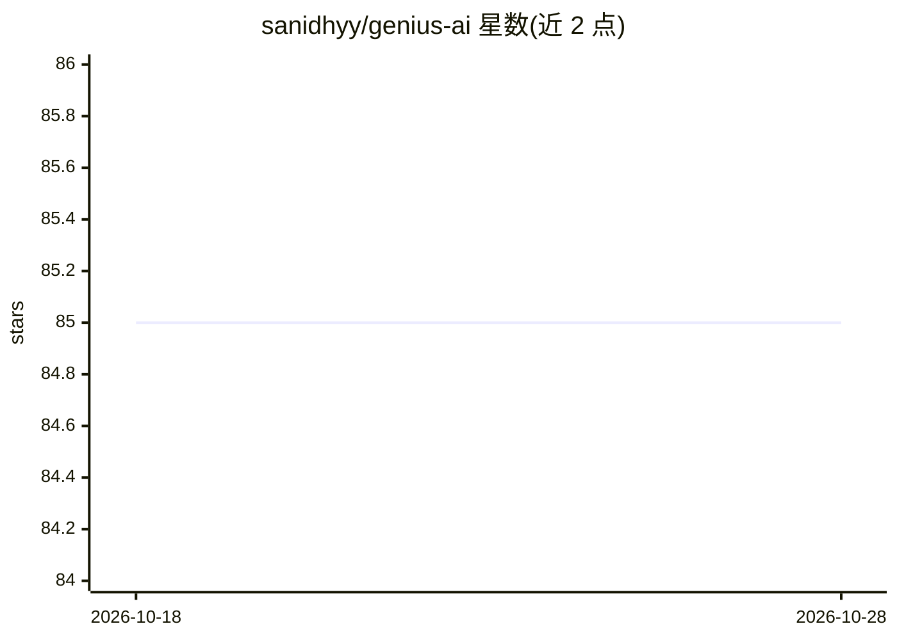

# sanidhyy/genius-ai

⭐ 85 · TypeScript · MIT · 推送 2026-10-26 · [GitHub](https://github.com/sanidhyy/genius-ai) · [官网](https://ai-genius.netlify.app/) · 个人维护

**Next.js 16 全栈 SaaS AI 平台：对话/图像/代码/音乐生成**

基于 Next.js 16、React 19、TypeScript、Prisma 与 MySQL 构建的 SaaS AI 应用，含对话、图像生成、代码生成、音乐生成页面。用户在 Settings 中配置自己的 OpenAI 与 Replicate 凭据，凭据经加密存储于 httpOnly cookie。集成 Clerk 认证、Aiven MySQL 数据库、Stripe 支付与 Crisp 客服组件，部署面向 Netlify/Vercel。安装需 Node.js 环境，配置十余项 .env 密钥后以 npm/pnpm 运行。

## 筛选速览

| 维度 | 判定 | 备注 |
|---|---|---|
| AI 角色 | `ai-native` | 本体是模型或模型工具 |
| 许可风险 | `permissive` | MIT |
| 部署形态 | `library` | 以包/库形式分发 |
| 模型依赖 | — | README 未给出锁定关系 |
| 硬件要求 | — | 无带数字的原话,不猜 |
| 安装摩擦 | `low` | 无编译、无系统依赖或容器化 |
| 成熟度 | — | 结构信号不足 |

## 能力要点

- 对话、图像生成、代码生成等多 AI 功能页面
- 用户自带 OpenAI/Replicate 凭据，加密存于 httpOnly cookie
- 集成 Clerk 认证、Stripe 支付、Aiven MySQL、Crisp 客服

## 适用场景

- 搭建带订阅付费的 AI 生成服务 SaaS 站点
- 学习 Next.js 全栈 AI 应用工程的结构与集成方式
- 作为带认证与支付的多模态 AI 应用脚手架二次开发

## 场景标签

`聊天机器人` `图像生成` `代码生成` · 领域:编码与开发

## 证据(README 行号)

> L1: # Genius - A Modern Next.js 16 SaaS AI Platform.
> L87: Generate two separate secrets with `openssl rand -hex 32` and set them as `AI_SETTINGS_COOKIE_NAME` and `VERIFICATI

## 星数曲线

2026-10-18 85 → 2026-10-28 85（+0）

---
*卡片 v1 · prompt 1.4 · 生成 2026-10-24 · 置信度 high · 依据 README sha `0b19b7764d10` · [字段定义](../../DATASET.md)*
