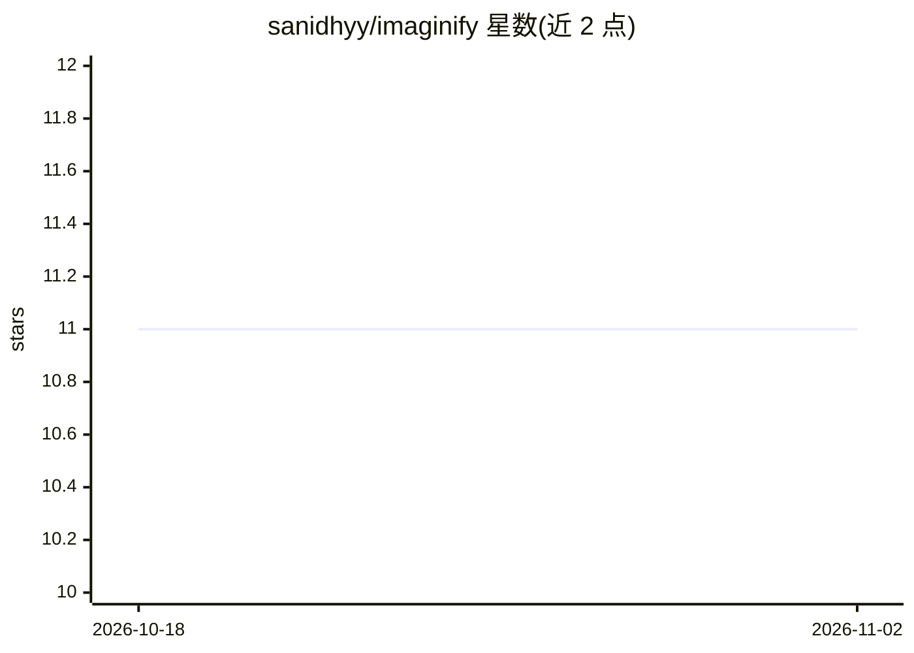

# sanidhyy/imaginify

⭐ 11 · TypeScript · MIT · 推送 2026-08-26 · [GitHub](https://github.com/sanidhyy/imaginify) · [官网](https://ai-imaginify.netlify.app/) · 个人维护

**面向用户的 AI 图像生成 Web 应用（Next.js）**

基于 Next.js/React/TypeScript 的 AI 图像生成应用：用户通过 Web 界面生成图像，配套 Clerk 登录认证、MongoDB 数据存储、Cloudinary 图像存储/管理、Stripe 积分购买与 Netlify 部署状态徽章。运行需自行配置 Clerk、MongoDB Atlas、Cloudinary、Stripe 等多组 API 密钥到 .env.local，再以 npm install --legacy-peer-deps 安装依赖并 npm run dev 启动。README 提供文件夹结构与分步配置说明，含截图与贡献指南。

## 筛选速览

| 维度 | 判定 | 备注 |
|---|---|---|
| AI 角色 | `ai-native` | 本体是模型或模型工具 |
| 许可风险 | `permissive` | MIT |
| 部署形态 | `library` | 以包/库形式分发 |
| 模型依赖 | — | README 未给出锁定关系 |
| 硬件要求 | — | 无带数字的原话,不猜 |
| 安装摩擦 | `low` | 无编译、无系统依赖或容器化 |
| 成熟度 | — | 结构信号不足 |

## 能力要点

- Web 界面的 AI 图像生成
- Clerk 认证 + MongoDB 存储
- Cloudinary 图像上传与管理
- Stripe 积分购买流程

## 适用场景

- 作为 AI 图像生成 SaaS 项目模板学习 Next.js 全栈开发
- 部署一个带登录与付费的图像生成站点
- 了解 Clerk/Cloudinary/Stripe 集成方式

## 场景标签

`图像生成` · 领域:内容生成

## 证据(README 行号)

> L1: # Imaginify - AI powered image generator.
> L3: Imaginify - AI powered image generator.

## 星数曲线

2026-10-18 11 → 2026-11-02 11（+0）

---
*卡片 v1 · prompt 1.4 · 生成 2026-11-01 · 置信度 mid · 依据 README sha `6f83fd45edab` · [字段定义](../../DATASET.md)*
