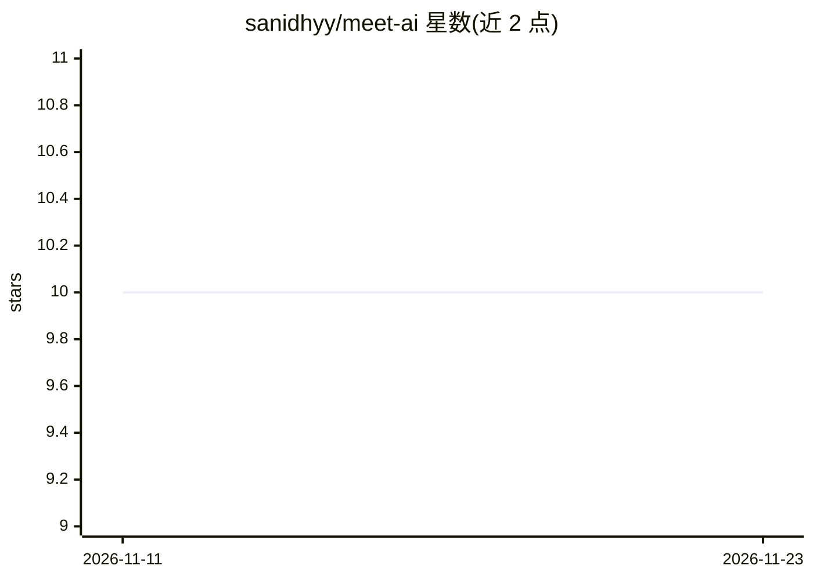

# sanidhyy/meet-ai

⭐ 10 · TypeScript · MIT · 推送 2026-11-19 · [GitHub](https://github.com/sanidhyy/meet-ai) · [官网](https://app-meetai.vercel.app) · 个人维护

**给需要视频会议与纪要的用户提供 AI 聊天助手与会议摘要应用**

基于 Next.js 15 与 Stream Video 构建的会议应用，提供实时视频会议、聊天消息，以及 AI 聊天助手与会议摘要功能。依赖 GetStream 提供视频与聊天通道，OpenAI 相关 SDK 参与助手与摘要生成，Inngest 处理后台事件流程。安装需自建多个外部服务凭据：Neon PostgreSQL、GetStream、Polar 订阅支付、UploadThing 文件上传、GitHub/Google OAuth，并通过 npm/yarn/pnpm 安装依赖后本地运行。

## 筛选速览

| 维度 | 判定 | 备注 |
|---|---|---|
| AI 角色 | `ai-native` | 本体是模型或模型工具 |
| 许可风险 | `permissive` | MIT |
| 部署形态 | `library` | 以包/库形式分发 |
| 模型依赖 | — | README 未给出锁定关系 |
| 硬件要求 | — | 无带数字的原话,不猜 |
| 安装摩擦 | `low` | 无编译、无系统依赖或容器化 |
| 成熟度 | — | 结构信号不足 |

## 能力要点

- 基于 Stream Video 的实时视频会议与聊天
- AI 聊天助手与会议摘要生成（OpenAI SDK）
- Polar 订阅支付与 GitHub/Google OAuth 登录集成
- Inngest 后台工作流与 Stream webhook 事件联动

## 适用场景

- 自托管一个带 AI 摘要的视频会议站点
- 为团队会议生成聊天助手与纪要
- 基于该代码库学习 Next.js 全栈会议应用搭建

## 场景标签

`AI 助手` · 领域:对话与助手

## 证据(README 行号)

> L1: # AI-Powered Intelligent Chat Assistant and Meeting Summarizer using Next.js 15 and Stream Video
> L218: - @stream-io/openai-realtime-api: ^0.4.2
> L155: 15. Install Project Dependencies using `npm install --legacy-peer-deps` or `yarn install --legacy-peer-deps` or `p

## 星数曲线

2026-11-11 10 → 2026-11-23 10（+0）

---
*卡片 v1 · prompt 1.4 · 生成 2026-11-19 · 置信度 high · 依据 README sha `33c9688fc6da` · [字段定义](../../DATASET.md)*
