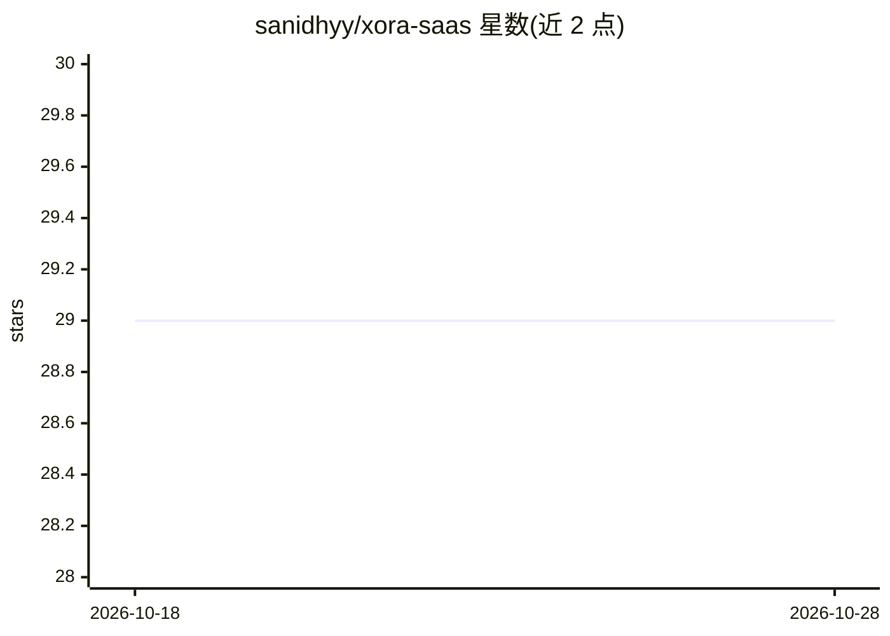

# sanidhyy/xora-saas

⭐ 29 · TypeScript · MIT · 推送 2026-08-26 · [GitHub](https://github.com/sanidhyy/xora-saas) · [官网](https://xora-saas.netlify.app) · 个人维护

**AI 视频剪辑 SaaS 的动画落地页模板（React）**

基于 React JS、Vite、Tailwind CSS 构建的 SaaS 落地页前端模板，主题定位为 AI 视频剪辑产品，包含现代 UI/UX、定价区块、动画效果与下载区块。README 提供 npm/yarn/bun 安装依赖（--legacy-peer-deps）与本地开发运行命令，并给出 Netlify 部署说明；附完整目录结构与依赖清单。注意：仓库内容为营销落地页，未见实际 AI 视频剪辑功能的实现或接入。

## 筛选速览

| 维度 | 判定 | 备注 |
|---|---|---|
| AI 角色 | `ai-enhanced` | 去掉 AI 部分产品仍成立 |
| 许可风险 | `permissive` | MIT |
| 部署形态 | `library` | 以包/库形式分发 |
| 模型依赖 | — | README 未给出锁定关系 |
| 硬件要求 | — | 无带数字的原话,不猜 |
| 安装摩擦 | `low` | 无编译、无系统依赖或容器化 |
| 成熟度 | — | 结构信号不足 |

## 能力要点

- React + Vite + Tailwind CSS 技术栈的落地页模板
- 含定价区块、动画效果与下载区块
- 提供 npm/yarn/bun 安装与本地开发命令
- 提供 Netlify 部署指引

## 适用场景

- 快速搭建 AI SaaS 产品的营销落地页
- 学习 React + Tailwind 的现代落地页实现
- 通过 Netlify 部署静态展示站点

## 场景标签

 · 领域:Web 前端/落地页模板

## 证据(README 行号)

> L1: # Xora - Modern Animated AI Video Editing SaaS Landing Page
> L56: React JS Vite JS Javascript Tailwind CSS Netlify

## 星数曲线

2026-10-18 29 → 2026-10-28 29（+0）

---
*卡片 v1 · prompt 1.4 · 生成 2026-10-26 · 置信度 mid · 依据 README sha `c6dedd880401` · [字段定义](../../DATASET.md)*
