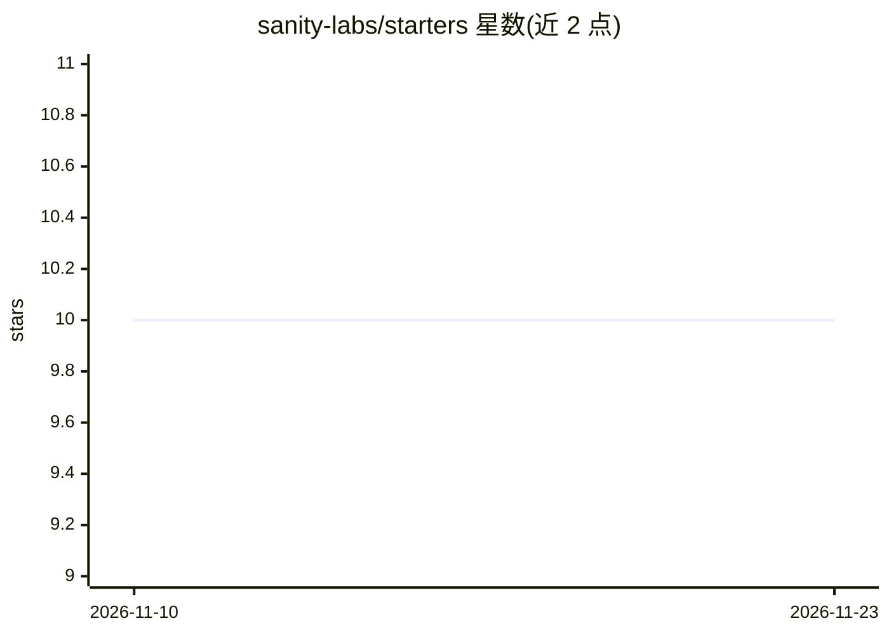

# sanity-labs/starters

⭐ 10 · TypeScript · 推送 2026-11-17 · [GitHub](https://github.com/sanity-labs/starters) · [官网](https://www.sanity.io) · 组织维护

**为 Sanity 开发者提供的生产就绪项目启动模板合集**

Sanity 官方实验室维护的启动模板集合，每个 starter 是可独立运行的项目，通过 Sanity CLI 一条命令创建。包含 6 个模板：带术语表与质量评估的 AI 翻译本地化、集成 Claude 聊天机器人的电商店面、知识库 Agent 检索、Shopify 商品列表/详情编辑层、内容运营分析。仓库为扁平结构，各 starter 拥有独立 package.json 与 CI 工作流，根目录提供 Husky、CI 等维护工具。

## 筛选速览

| 维度 | 判定 | 备注 |
|---|---|---|
| AI 角色 | `ai-enhanced` | 去掉 AI 部分产品仍成立 |
| 许可风险 | `none` | — |
| 部署形态 | `library` | 以包/库形式分发 |
| 模型依赖 | — | README 未给出锁定关系 |
| 硬件要求 | — | 无带数字的原话,不猜 |
| 安装摩擦 | `low` | 无编译、无系统依赖或容器化 |
| 成熟度 | — | 结构信号不足 |

## 能力要点

- 通过 pnpm/npm create sanity CLI 一键生成 starter 项目
- 6 个独立模板：AI 本地化、AI 购物助手、知识库、电商内容管理、内容运营分析
- 扁平结构，各 starter 独立运行，含自身 CI 工作流
- 提供 _scaffold 脚手架用于创建新 starter

## 适用场景

- 用 Sanity 快速搭建带 AI 翻译的本地化内容工作流
- 构建集成 Claude 聊天机器人的电商店面
- 为 Shopify 商品页添加编辑化内容管理层
- 基于私有数据集搭建知识库检索问答

## 场景标签

`聊天机器人` `RAG` · 领域:对话与助手

## 证据(README 行号)

> L3: Production-ready starter templates for building with Sanity.
> L17: |agentic-localization|AI translation with glossaries, style guides, quality evals, and a translations dashboard|
> L18: |ai-shopping-assistant|Ecommerce storefront with a Claude chatbot powered by Context MCP|

## 星数曲线

2026-11-10 10 → 2026-11-23 10（+0）

---
*卡片 v1 · prompt 1.4 · 生成 2026-11-19 · 置信度 high · 依据 README sha `dde9a38481a9` · [字段定义](../../DATASET.md)*
