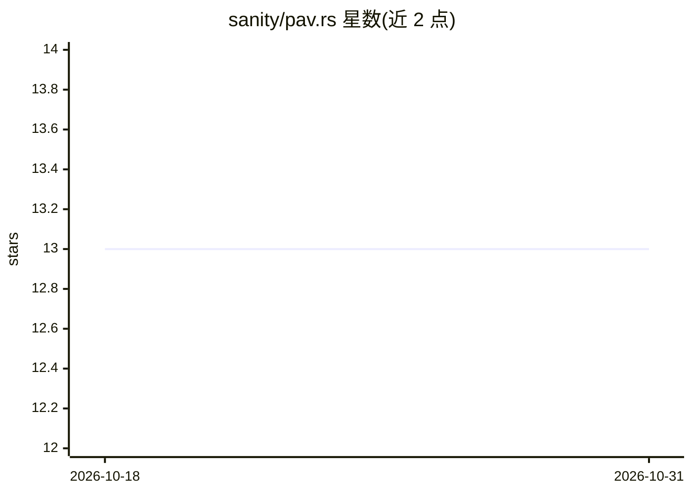

# sanity/pav.rs

⭐ 13 · Rust · 推送 2026-03-25 · [GitHub](https://github.com/sanity/pav.rs) · [官网](https://crates.io/crates/pav_regression) · 个人维护

**Rust 实现的保序回归（PAV 算法）库**

Pair Adjacent Violators 算法的 Rust 实现，用于保序回归：输入带噪声的 (x, y) 观测数据，拟合单调递增或递减关系，支持由 x 预测 y 或反推给定 y 所需的 x。训练数据域之外的取值通过外推计算，点间采用线性插值。以 crates.io 上的库（pav_regression）形式提供，供 Rust 开发者在自身项目中调用，LGPL-3 许可发布；同一作者另有 Kotlin/JVM 早期实现。

## 筛选速览

| 维度 | 判定 | 备注 |
|---|---|---|
| AI 角色 | `ai-native` | 本体是模型或模型工具 |
| 许可风险 | `none` | — |
| 部署形态 | `library` | 以包/库形式分发 |
| 模型依赖 | — | README 未给出锁定关系 |
| 硬件要求 | — | 无带数字的原话,不猜 |
| 安装摩擦 | `low` | 无编译、无系统依赖或容器化 |
| 成熟度 | — | 结构信号不足 |

## 能力要点

- PAV 算法拟合单调递增/递减关系
- 支持反向查询：给定 y 反推所需 x
- 训练域外智能外推与点间线性插值

## 适用场景

- 从带噪声观测数据学习单调关系并预测
- 自动驾驶油门压力-加速度等控制量标定
- 自动扩容场景按流量预测所需服务器数

## 场景标签

 · 领域:机器学习/统计

## 证据(README 行号)

> L8: An implementation of the
> L40: _x_ and _y_, and then use this to allow us to predict _y_ given _x_, or to predict what value of _x_

## 星数曲线

2026-10-18 13 → 2026-10-31 13（+0）

---
*卡片 v1 · prompt 1.4 · 生成 2026-10-31 · 置信度 high · 依据 README sha `2c79b09d9b31` · [字段定义](../../DATASET.md)*
