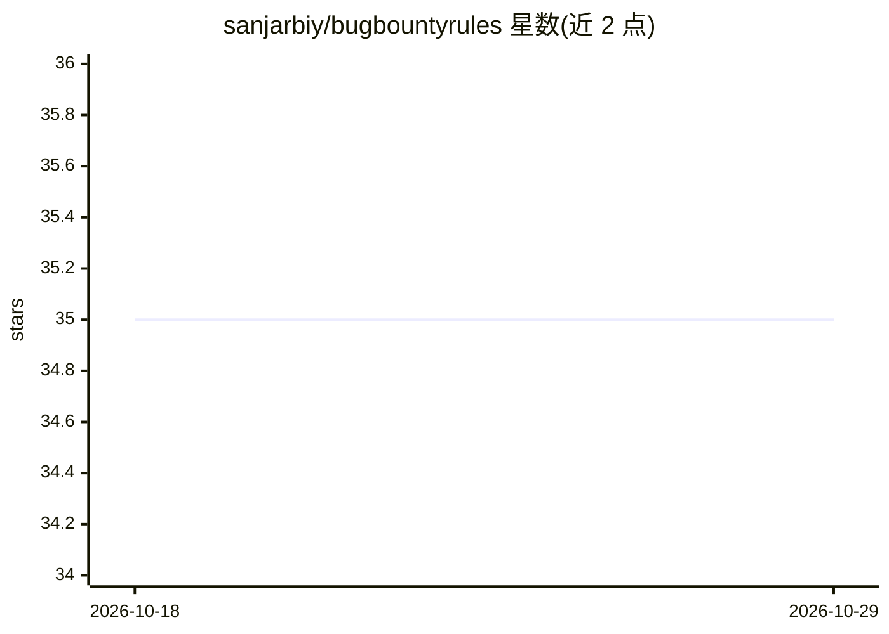

# sanjarbiy/bugbountyrules

⭐ 35 · Shell · MIT · 推送 2026-08-18 · [GitHub](https://github.com/sanjarbiy/bugbountyrules) · 个人维护

**AI agent 行为约束技能：42 条规则约束授权渗透测试流程**

面向 Claude Code 及兼容运行时的 agent 技能（SKILL.md），以 42 条常驻规则约束 AI agent 在授权漏洞赏金与渗透测试中的行为：范围执行、误报三角色门禁、严重性锚定、覆盖台账与卡死循环；配合渐进式披露的参考知识库，通过 Hunt Reflex 与固定操作流程驱动会话。覆盖 web/API/移动/云/LLM 攻击面，限定授权测试场景，厂商中立、无硬编码工具依赖。

## 筛选速览

| 维度 | 判定 | 备注 |
|---|---|---|
| AI 角色 | `ai-ecosystem` | LLM/agent 周边工具 |
| 许可风险 | `permissive` | MIT |
| 部署形态 | `None` |  |
| 模型依赖 | — | README 未给出锁定关系 |
| 硬件要求 | — | 无带数字的原话,不猜 |
| 安装摩擦 | `low` | 无编译、无系统依赖或容器化 |
| 成熟度 | — | 结构信号不足 |

## 能力要点

- 42 条常驻规则，覆盖范围、误报门禁、覆盖台账与卡死处理
- SKILL.md 常载 + reference/ 知识库按需加载的渐进式披露
- Hunter->Skeptic->Referee 三角色对抗式验证
- 支持本地廉价模型分流与前沿模型第二意见的分工机制

## 适用场景

- 我需要让 AI agent 按纪律执行授权漏洞赏金任务，减少误报和严重性夸大
- 我希望 agent 不遗漏攻击面、不重复测试并遵守项目范围
- 渗透测试报告中要求证据充分、表述精确

## 场景标签

`网络安全` · 领域:学习与行业

## 证据(README 行号)

> L3: **A behavioral-discipline skill for authorized bug bounty & penetration testing.** It turns an AI agent into a metho
> L9: An agent skill (Claude Code and compatible runtimes) that governs *how* an agent hunts - the discipline that separat
> L25: **One always-loaded core, everything else on demand.** `SKILL.md` (the 42 rules, ~1,500 lines) is loaded for the wh

## 星数曲线

2026-10-18 35 → 2026-10-29 35（+0）

---
*卡片 v1 · prompt 1.4 · 生成 2026-10-25 · 置信度 high · 依据 README sha `cf5292a7a931` · [字段定义](../../DATASET.md)*
