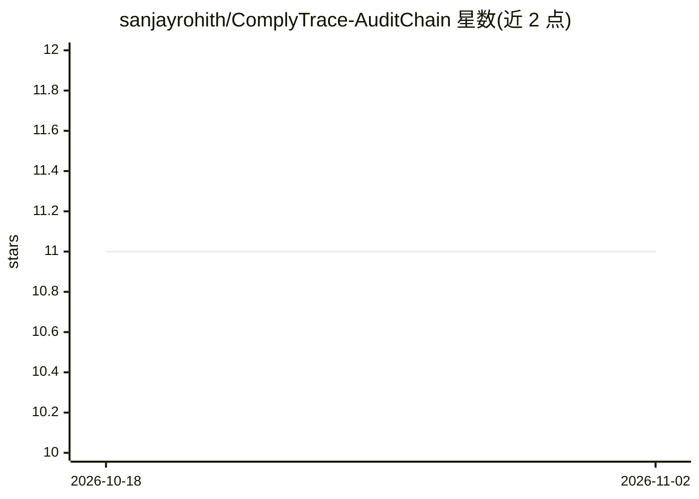

# sanjayrohith/ComplyTrace-AuditChain

⭐ 11 · TypeScript · 推送 2026-07-26 · [GitHub](https://github.com/sanjayrohith/ComplyTrace-AuditChain) · 个人维护

**面向企业的 AI 法规合规平台：RAG 匹配州法并生成披露文件与审计链**

面向部署 AI 系统的企业合规平台：注册组织与 AI 系统后，通过 1024 维向量嵌入与余弦相似度在州级 AI 法规语料库中做 RAG 匹配，生成引用真实法条原文、含来源溯源与『非法律意见』免责声明的披露文件；所有合规操作记录于 SHA-256 哈希链审计日志，数据库层面 REVOKE UPDATE/DELETE 防篡改，并提供 x-api-key 认证的 REST API 供外部系统写入。嵌入用 all-MiniLM-L6-v2 本地计算，文本生成接 Anthropic Claude，无 key 时回退模板。技术栈为 Next.js + PostgreSQL/pgvector + Drizzle，Docker Compose 部署，README 自述部署超出演示用途前需额外加固。

## 筛选速览

| 维度 | 判定 | 备注 |
|---|---|---|
| AI 角色 | `ai-native` | 本体是模型或模型工具 |
| 许可风险 | `none` | — |
| 部署形态 | `self-host` | docker 或自建部署 |
| 模型依赖 | locked-api |  |
| 硬件要求 | — | 无带数字的原话,不猜 |
| 安装摩擦 | `low` | 无编译、无系统依赖或容器化 |
| 成熟度 | `idea` | |

## 能力要点

- RAG 语义匹配州级 AI 法规（all-MiniLM-L6-v2 嵌入 + 余弦相似度）
- 披露文件引用法条原文并强制附带『非法律意见』免责声明
- SHA-256 哈希链审计日志 + DB 级只读强制，可公开验证完整性
- REST API（x-api-key）供外部系统直接记录 AI 决策到审计链

## 适用场景

- 注册我们的 AI 系统并查看各州适用法规与合规状态
- 自动生成有法条引用的合规披露文件
- 为监管方/审计方提供可验证的防篡改合规记录
- 通过 API 把内部系统的 AI 决策写入统一审计链

## 场景标签

`RAG` `AI 写作` · 领域:内容生成

## 证据(README 行号)

> L29: ComplyTrace uses **Retrieval-Augmented Generation (RAG)** to automatically match your AI systems against a corpus o
> L53: Each AI system you register gets analyzed against our law corpus using semantic vector search:
> L62: Generate compliance disclosure documents that cite the actual law passages they're based on. Every disclosure inclu

## 星数曲线

2026-10-18 11 → 2026-11-02 11（+0）

---
*卡片 v1 · prompt 1.4 · 生成 2026-11-01 · 置信度 high · 依据 README sha `e6b6068b460b` · [字段定义](../../DATASET.md)*
