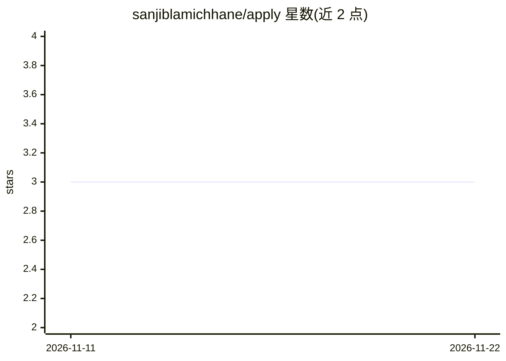

# sanjiblamichhane/apply

⭐ 3 · TypeScript · Apache-2.0 · 推送 2026-11-15 · [GitHub](https://github.com/sanjiblamichhane/apply) · 个人维护

**本地运行的求职 agent：生成简历、求职信并填表**

面向求职者的自托管应用：粘贴职位后由本地模型从个人档案生成定制简历与求职信，带声明核查（标记档案无法支撑的内容），浏览器扩展在受支持招聘网站的表单中预览并填写资料、附件 PDF 与保存的答案，但始终由用户手动提交。支持职位、公共招标、资助与合同四类 pack，英文/尼泊尔语/西班牙语，内置英国 Contracts Finder 与 Grants.gov 来源抓取与匹配评分。需 Docker、本地模型服务器与 Pango。

## 筛选速览

| 维度 | 判定 | 备注 |
|---|---|---|
| AI 角色 | `ai-native` | 本体是模型或模型工具 |
| 许可风险 | `permissive` | Apache-2.0 |
| 部署形态 | `self-host` | docker 或自建部署 |
| 模型依赖 | — | README 未给出锁定关系 |
| 硬件要求 | — | 无带数字的原话,不猜 |
| 安装摩擦 | `low` | 无编译、无系统依赖或容器化 |
| 成熟度 | — | 结构信号不足 |

## 能力要点

- 本地模型生成简历与求职信，档案不出本机
- 声明核查标记档案不支持的陈述
- 浏览器扩展填表但不自动提交，用户自行按 Submit
- MCP server 供 Claude、Cursor 等 agent 读取申请与档案

## 适用场景

- 为每个职位定制生成简历和求职信
- 让浏览器扩展代填招聘网站的申请表单
- 自动抓取公司招聘页、英国招标与美国资助信息并匹配评分

## 场景标签

`AI 写作` `浏览器自动化` `网页抓取` · 领域:效率与自动化

## 证据(README 行号)

> L5:  Finds roles, writes a tailored résumé and cover letter for each one, and fills in the application form.
> L28: - **Private by design.** It runs on your computer with a local model (any server speaking the native
> L158: 4. **Documents**: a resume and cover letter written for each application by your model. A claim check flags

## 星数曲线

2026-11-11 3 → 2026-11-22 3（+0）

---
*卡片 v1 · prompt 1.4 · 生成 2026-11-21 · 置信度 mid · 依据 README sha `2429fc77c98a` · [字段定义](../../DATASET.md)*
