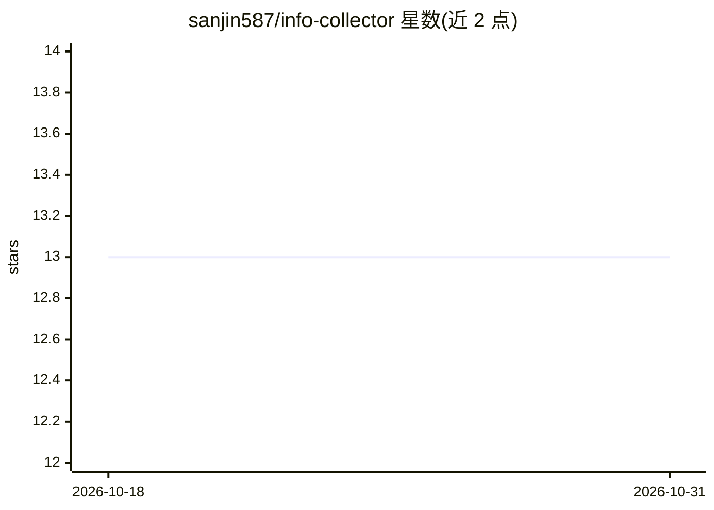

# sanjin587/info-collector

⭐ 13 · Python · MIT · 推送 2026-09-24 · [GitHub](https://github.com/sanjin587/info-collector) · 个人维护 · 中文 README

**把 X 帖文和抖音/小红书视频转为 Markdown 逐字稿并归档的工作流**

本地优先的内容采集工作流：输入可访问的 X/抖音/小红书链接或本地音视频，通过 Whisper（本地离线，CPU/GPU）或 Paraformer（在线 API）转录为带来源的 Markdown 逐字稿，并可写入飞书多维表格或 Obsidian 知识库。搜索与批量采集依赖可选上游组件 agent-reach 与 MediaCrawler，本仓库提供统一入口 collector.py、降级链与归档自动化。面向整理内容素材的创作者和研究者；平台可获取性受上游工具、登录状态与平台规则影响。

## 筛选速览

| 维度 | 判定 | 备注 |
|---|---|---|
| AI 角色 | `ai-native` | 本体是模型或模型工具 |
| 许可风险 | `permissive` | MIT |
| 部署形态 | `library` | 以包/库形式分发 |
| 模型依赖 | — | README 未给出锁定关系 |
| 硬件要求 | — | 无带数字的原话,不猜 |
| 安装摩擦 | `low` | 无编译、无系统依赖或容器化 |
| 成熟度 | — | 结构信号不足 |

## 能力要点

- X 帖文转 Markdown（依赖 FxTwitter），抖音/小红书视频转带来源逐字稿
- Whisper 本地离线转录（CPU/GPU）+ Paraformer 在线转录可选
- 飞书多维表格同步与 Obsidian 归档，按 URL 去重
- 同时作为 Claude Code Skill，对话中说“信息采集官”自动加载三层能力

## 适用场景

- 把一条可访问的视频链接整理成可检查的逐字稿
- 将本地 MP4/MP3 转成可搜索文字并归档到 Obsidian
- 自行配置凭证后把采集资料同步到飞书多维表格

## 场景标签

`工作流自动化` `语音识别` `网页抓取` · 领域:效率与自动化

## 证据(README 行号)

> L3: **X 帖文转 Markdown、抖音/小红书视频转逐字稿的开源工具工作流。** 输入可访问的链接或你已取得的本地媒体，生成带来源、可检查的文字，再按需归档到 Obsidian 或同步到飞书；也可接入外部搜索和批量采集工具。
> L146: - **Whisper** — 模型文件准备好后可在本地离线转录，支持 CPU/GPU
> L45: |将可获取的音视频转为逐字稿并本地保存|`pipeline` / `transcribe`|转录依赖、可访问的媒体；部分平台可能要求登录|

## 星数曲线

2026-10-18 13 → 2026-10-31 13（+0）

---
*卡片 v1 · prompt 1.4 · 生成 2026-10-31 · 置信度 high · 依据 README sha `9091187a62a2` · [字段定义](../../DATASET.md)*
