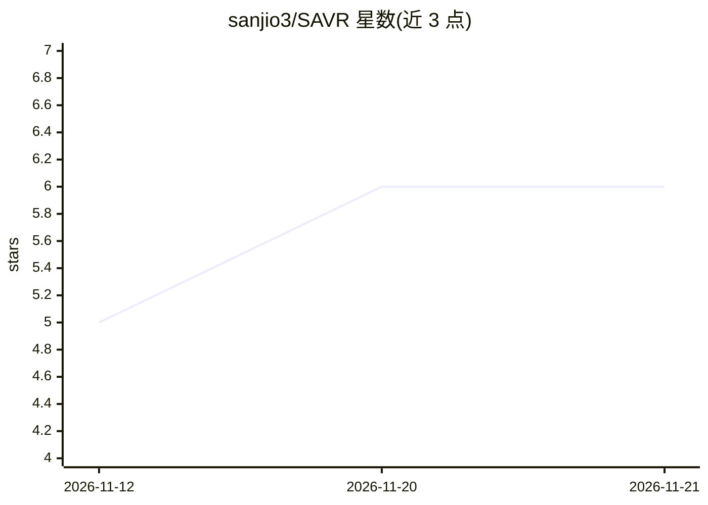

# sanjio3/SAVR

⭐ 6 · Python · Apache-2.0 · 推送 2026-11-18 · [GitHub](https://github.com/sanjio3/SAVR) · [官网](https://github.com/sanjio3/SAVR/releases/latest) · 个人维护 · 中文 README

**用本地 LLM 与确定性重放确认 SAST 漏洞报告的扫描流水线**

四阶段安全流水线：A1 用 CodeQL 官方查询套件加自定义 .ql 查询做静态分析产出候选发现；A2 对每个 sink 文件调用一次 LLM，返回判定与 JSON 校验的触发规格；D1/D2 将规格确定性重放到运行中的目标，须有探针事件、家族 oracle 或带外回调等结构化影响证据才确认。LLM 不接触目标，失败结果保留终态与归因。需 Python 3.12+、Node.js 20+、JDK 11+ 与 Maven 自建 IAST 探针，UI 仅中文。

## 筛选速览

| 维度 | 判定 | 备注 |
|---|---|---|
| AI 角色 | `ai-native` | 本体是模型或模型工具 |
| 许可风险 | `permissive` | Apache-2.0 |
| 部署形态 | `None` |  |
| 模型依赖 | local-ok | 支持本地模型 |
| 硬件要求 | — | 无带数字的原话,不猜 |
| 安装摩擦 | `medium` | 含编译或系统依赖之一 |
| 成熟度 | — | 结构信号不足 |

## 能力要点

- CodeQL 官方套件+自定义查询+确定性启发式兜底的静态分析
- 每个 sink 一次 LLM 调用，JSON 校验带一轮修复，失败记录为 analysis_error
- 确认需结构化影响证据：探针事件/家族 oracle/带外回调
- 未确认候选保留终态与失败归因，可区分漏报与目标不可达

## 适用场景

- 对 Java 项目做 SAST 结果的自动化确认，减少误报排查
- 在 CI 中要求每个发现附可复现的触发证据
- 安全团队用本地 LLM 审计代码而不让模型接触目标系统

## 场景标签

`网络安全` · 领域:学习与行业

## 证据(README 行号)

> L5: An automated white-box vulnerability scanning and verification pipeline: static analysis
> L6: produces candidate findings, and a local LLM returns a verdict plus a machine-usable trigger spec;
> L8: only on structured impact evidence. The LLM never touches the target; everything downstream

## 星数曲线

2026-11-12 5 → 2026-11-21 6（+1）

---
*卡片 v1 · prompt 1.4 · 生成 2026-11-20 · 置信度 high · 依据 README sha `f7513b1a82ee` · [字段定义](../../DATASET.md)*
