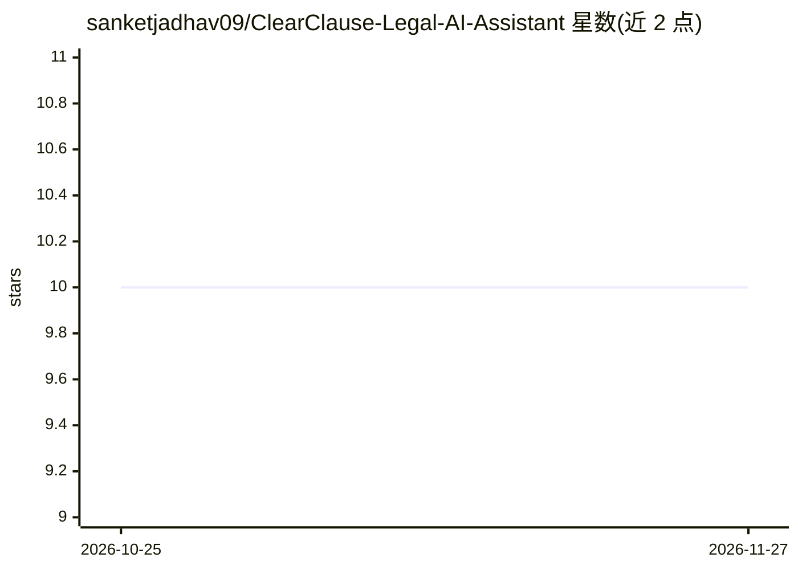

# sanketjadhav09/ClearClause-Legal-AI-Assistant

⭐ 10 · Python · MIT · 推送 2026-06-06 · [GitHub](https://github.com/sanketjadhav09/ClearClause-Legal-AI-Assistant) · [官网](https://clearclause-ai.streamlit.app/) · 个人维护

**基于 Gemini 的法律文档问答、摘要与翻译助手**

基于 Streamlit 的法律 AI 助手，用户上传 PDF/DOCX 法律文档后可进行问答、按自定义指令生成摘要、将英文法律文本翻译为印地语或马拉地语，并对文档做语义检索。核心为 RAG 流程：文档解析、分块后经 LangChain embeddings 建立向量索引，检索结果送入 Gemini 模型生成输出。需要用户提供 Google Gemini API Key，支持本地运行与 Streamlit Community Cloud 部署。

## 筛选速览

| 维度 | 判定 | 备注 |
|---|---|---|
| AI 角色 | `ai-native` | 本体是模型或模型工具 |
| 许可风险 | `permissive` | MIT |
| 部署形态 | `library` | 以包/库形式分发 |
| 模型依赖 | — | README 未给出锁定关系 |
| 硬件要求 | — | 无带数字的原话,不猜 |
| 安装摩擦 | `low` | 无编译、无系统依赖或容器化 |
| 成熟度 | — | 结构信号不足 |

## 能力要点

- 多文档上传（PDF/DOCX）后的上下文问答与聊天记录
- FAISS 向量索引支持文档语义检索（RAG 流程）
- 按用户指令生成摘要与英译印地语/马拉地语翻译

## 适用场景

- 上传合同等法律文档后针对内容提问
- 按自定义指令生成法律文档摘要
- 将英文法律文本翻译为印地语或马拉地语

## 场景标签

`文档问答` `文档解析` `RAG` `AI 写作` · 领域:内容生成

## 证据(README 行号)

> L6: **ClearClause** is a Streamlit-based **Legal AI Assistant** designed to help users interact with their legal documen
> L15: The system uses **Google’s Gemini 2.5 Flash model** for **QnA, summarization, and translation**, and **FAISS vector

## 星数曲线

2026-10-25 10 → 2026-11-27 10（+0）

---
*卡片 v1 · prompt 1.4 · 生成 2026-11-19 · 置信度 high · 依据 README sha `5a0bd1449d48` · [字段定义](../../DATASET.md)*
