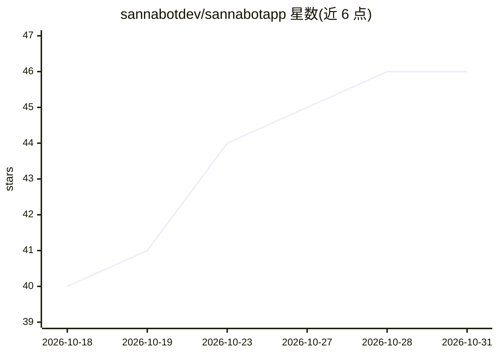

# sannabotdev/sannabotapp

⭐ 46 · TypeScript · 推送 2026-03-27 · [GitHub](https://github.com/sannabotdev/sannabotapp) · 组织维护

**Android 语音 AI 助手：通过 LLM agent 循环直接操控手机**

开源 Android 语音优先 AI 助手，基于 React Native 与原生 Kotlin 构建。工作流程为唤醒词→STT→LLM→TTS 的 agent 循环，可读写邮件、收发消息（WhatsApp/SMS/通话）、管理日历任务与通知、运行后台子代理的定时任务，并借助 Android Accessibility 无 API 操控第三方应用；数据存储在设备本地、无需后端。模型支持 OpenAI 或 Claude。获取方式：邮件申请 beta APK，或自行 npm 构建源码；当前面向技术型 beta 测试者，完整配置可能需要多个 API key。

## 筛选速览

| 维度 | 判定 | 备注 |
|---|---|---|
| AI 角色 | `ai-native` | 本体是模型或模型工具 |
| 许可风险 | `none` | — |
| 部署形态 | `library` | 以包/库形式分发 |
| 模型依赖 | — | README 未给出锁定关系 |
| 硬件要求 | — | 无带数字的原话,不猜 |
| 安装摩擦 | `low` | 无编译、无系统依赖或容器化 |
| 成熟度 | `idea` | |

## 能力要点

- 唤醒词→STT→LLM→TTS 语音链路与工具调用 agent 循环
- Android Accessibility 实现无 API 第三方应用操控与多步链式动作
- 后台子代理：定时任务、通知评估与自动执行
- 设备本地存储、无后端；Markdown SKILL.md 可扩展技能

## 适用场景

- 开车时免手操作读邮件、回消息、查日历
- 让助手链式完成邮件总结后发送给联系人
- 定时后台任务：每早自动简报日程
- 操控没有 API 的第三方应用（如自动点赞）

## 场景标签

`语音 Agent` `AI 助手` `GUI 自动化` · 领域:效率与自动化

## 证据(README 行号)

> L8: It can read emails, send messages, manage notifications, schedule tasks, and operate Android apps hands-free through
> L90: - **Voice-first** — wake word → STT → LLM → TTS

## 星数曲线

2026-10-18 40 → 2026-10-31 46（+6）

---
*卡片 v1 · prompt 1.4 · 生成 2026-10-25 · 置信度 high · 依据 README sha `544e3ae623f5` · [字段定义](../../DATASET.md)*
