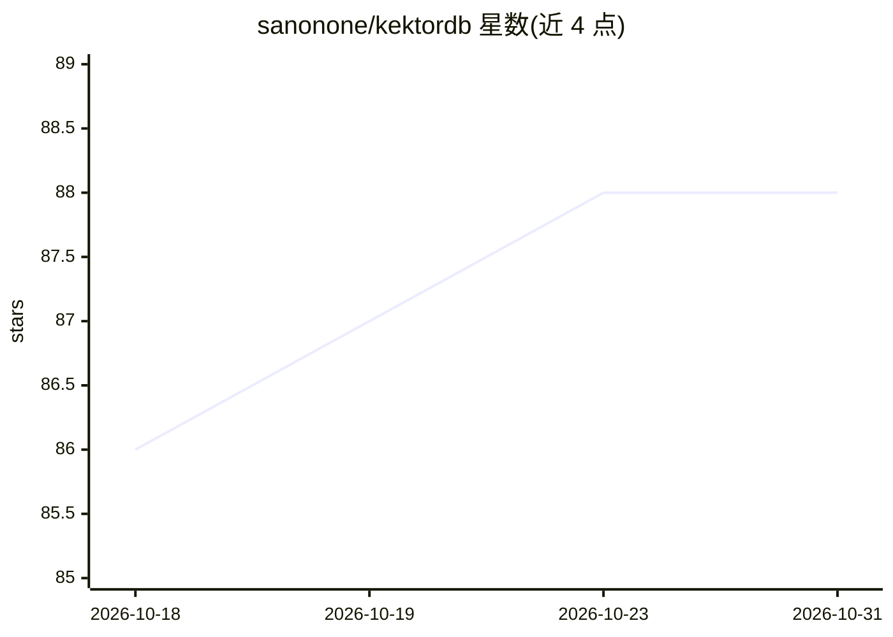

# sanonone/kektordb

⭐ 88 · Go · NOASSERTION · 推送 2026-10-12 · [GitHub](https://github.com/sanonone/kektordb) · 个人维护

**面向 AI agent 的记忆系统：向量检索+时序知识图谱+认知引擎**

用 Go 编写的 AI 记忆层，将 HNSW 向量检索、BM25 关键词匹配与带时间遍历的加权知识图谱结合，并以后台认知引擎（Gardener）持续分析数据：合并重复记忆、检测并解决矛盾、构建用户画像、按 Ebbinghaus 等模型做记忆衰减与强化。提供记忆版本控制（Semantic Git）、确定性置信评分（Epistemic Engine）与知识产物编译缓存。可作 MCP 服务器（57 个工具）、REST 服务器、嵌入式 Go 库或零代码 RAG 网关运行，内置 ONNX 本地嵌入模型，支持 Ollama/OpenAI/Gemini 嵌入 API。限制：单节点、不支持集群。以 GitHub Releases 二进制、pip/npm 客户端 SDK 提供。

## 筛选速览

| 维度 | 判定 | 备注 |
|---|---|---|
| AI 角色 | `ai-ecosystem` | LLM/agent 周边工具 |
| 许可风险 | `none` | NOASSERTION |
| 部署形态 | `self-host` | docker 或自建部署 |
| 模型依赖 | local-ok | 支持本地模型 |
| 硬件要求 | — | 无带数字的原话,不猜 |
| 安装摩擦 | `low` | 无编译、无系统依赖或容器化 |
| 成熟度 | — | 结构信号不足 |

## 能力要点

- 49 个 agent 工具的 MCP 服务器模式（记忆 CRUD、图操作、会话管理、认知特性）
- 时序知识图谱与记忆衰减/强化（episodic/semantic/procedural 分层配置）
- 基于 LLM 的矛盾检测与可自动解决轻微矛盾的 Gardener 后台进程
- 记忆版本控制（superseded_by/evolves_from 边）支持任意时间点知识状态查询

## 适用场景

- 给 Claude/Cursor/Gemini CLI 等 agent 客户端接入持久化记忆
- 作为应用的后端记忆库，通过 REST 或嵌入式 Go 库使用
- 在 Chat UI 与 LLM 之间做零代码 RAG 网关

## 场景标签

`Agent 记忆` `知识图谱` `RAG` `向量数据库` · 领域:Agent 开发

## 证据(README 行号)

> L19: KektorDB is an **AI memory system** - not a database that stores data, but an engine that **understands** what it s
> L75: |**MCP Server**|`kektordb --mcp --tools=agent`|AI agent memory (Claude, Cursor, Codex, Gemini CLI, OpenCode)|
> L77: |**Go Library**|`import "github.com/sanonone/kektordb/pkg/engine"`|Embedded in-process, zero network overhead|

## 星数曲线

2026-10-18 86 → 2026-10-31 88（+2）

---
*卡片 v1 · prompt 1.4 · 生成 2026-10-23 · 置信度 mid · 依据 README sha `1858ac696846` · [字段定义](../../DATASET.md)*
