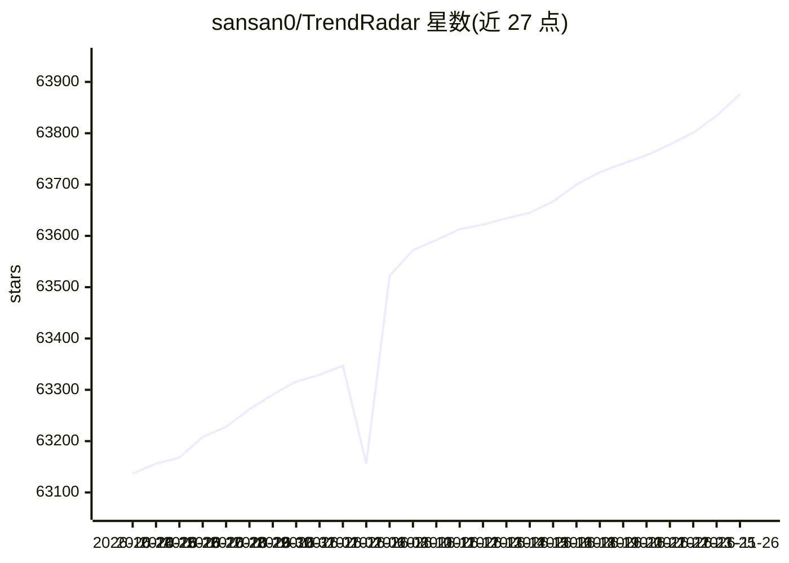

# sansan0/TrendRadar

⭐ 63,876 · Python · GPL-3.0 · 推送 2026-11-21 · [GitHub](https://github.com/sansan0/TrendRadar) · [官网](https://trendradar.sandev.cc) · 个人维护 · 中文 README

**个人舆情热点监控工具：聚合热搜与 RSS，AI 筛选分析并推送**

聚合多平台热榜（经 newsnow API）、RSS 订阅与定时联网搜索，按关键词或 AI 兴趣描述筛选新闻，经 AI 翻译与分析后推送到飞书、钉钉、企微、Telegram、邮件、ntfy、Bark 等 9 类渠道。AI 模块经 LiteLLM 统一接入 100+ 提供商；提供 MCP Server（20+ 工具）供 AI 客户端查询数据、读取正文与推送消息。支持 Docker、GitHub Actions、Cloudflare Pages 与本地部署，数据本地或云端自持。

## 筛选速览

| 维度 | 判定 | 备注 |
|---|---|---|
| AI 角色 | `ai-enhanced` | 去掉 AI 部分产品仍成立 |
| 许可风险 | `viral` | GPL-3.0 |
| 部署形态 | `self-host` | docker 或自建部署 |
| 模型依赖 | local-ok | 支持本地模型 |
| 硬件要求 | — | 无带数字的原话,不猜 |
| 安装摩擦 | `low` | 无编译、无系统依赖或容器化 |
| 成熟度 | — | 结构信号不足 |

## 动量与使用信号

- 维护:`active` — 距上次 push 2.8 天,年发版 0,9 位贡献者
- 涨星:近 1 天 **+49**(自 20261016 起算)
- 平台:LINUX · 协议:MCP / OLLAMA

## 能力要点

- 多平台热榜 + RSS + 定时联网搜索三类数据源
- AI 兴趣描述智能筛选，失败自动回退关键词匹配
- MCP Server 提供搜索、正文读取、推送等 20+ 工具
- 9 类推送渠道与 HTML 报告/Markdown 导出

## 适用场景

- 只推送我关注行业的新闻热点，不再逐个刷平台热搜
- 把每日热点与 AI 分析简报定时推到手机
- 让 AI 客户端通过 MCP 查询与检索热点数据

## 场景标签

`工作流自动化` · 领域:效率与自动化

## 证据(README 行号)

> L5: 最快 30秒 部署的热点助手 —— 告别无效刷屏，只看真正关心的新闻资讯
> L349: - **统一 AI 接口**：使用 LiteLLM 替代手动实现，支持 100+ AI 提供商

## 星数曲线

2026-10-24 63,137 → 2026-11-26 63,876（+739）

---
*卡片 v1 · prompt 1.4 · 生成 2026-11-22 · 置信度 mid · 依据 README sha `f004cf74926d` · [字段定义](../../DATASET.md)*
