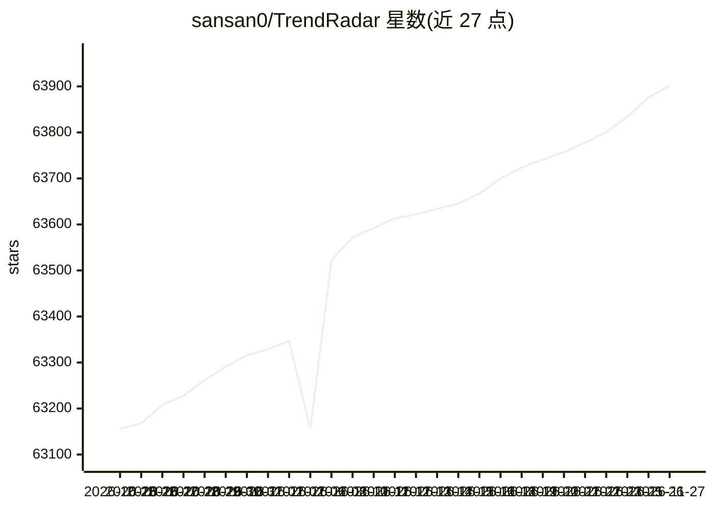

# sansan0/TrendRadar

⭐ 63,902 · TypeScript · GPL-3.0 · 推送 2026-11-26 · [GitHub](https://github.com/sansan0/TrendRadar) · [官网](https://sansan0.github.io/TrendRadar/) · 个人维护 · 中文 README

**个人舆情热点监控助手：聚合多平台热榜并用 AI 筛选分析**

聚合多平台热榜、RSS 订阅与定时联网搜索三类数据源，按关键词或 AI 兴趣描述筛选后推送到微信/飞书/钉钉/Telegram/邮件等 9 类渠道；AI 模块经 LiteLLM 接入多家模型，提供标题翻译、内容打分筛选、分析简报（趋势、情感倾向）与 MCP Server 供 AI 客户端检索。支持 Docker、本地、GitHub Actions、Cloudflare Pages 等部署方式，数据本地或云端自持。README 未列硬性硬件要求。

## 筛选速览

| 维度 | 判定 | 备注 |
|---|---|---|
| AI 角色 | `ai-native` | 本体是模型或模型工具 |
| 许可风险 | `viral` | GPL-3.0 |
| 部署形态 | `self-host` | docker 或自建部署 |
| 模型依赖 | local-ok | 支持本地模型 |
| 硬件要求 | — | 无带数字的原话,不猜 |
| 安装摩擦 | `low` | 无编译、无系统依赖或容器化 |
| 成熟度 | — | 结构信号不足 |

## 动量与使用信号

- 维护:`active` — 距上次 push 2.8 天,年发版 0,9 位贡献者
- 涨星:近 1 天 **+49**(自 20261016 起算)
- 平台:LINUX · 协议:MCP / OLLAMA

## 能力要点

- 热榜 + RSS + 定时联网搜索三类数据源聚合
- AI 智能筛选：用自然语言描述兴趣自动打分，失败回退关键词匹配
- 经 LiteLLM 统一接入 100+ 模型提供商，支持重试与备用模型
- 内置 MCP Server 提供 20+ 工具供 AI 客户端检索与推送

## 适用场景

- 每天定时收一份自己关注领域的热点与 AI 分析简报
- 按行业/公司/政策关键词追踪全网舆情动态
- 通过 MCP 在 AI 客户端里检索历史热点与新闻正文

## 场景标签

`工作流自动化` · 领域:效率与自动化

## 证据(README 行号)

> L216: - **更懂内容的质量筛选漏斗**：默认接入 DeepSeek 网页搜索接口（架构可扩展其他搜索引擎），支持用相关性分数、网站权威度、近几天新鲜度和每个主题最多展示条数层层把关，并支持「智能口语提炼」（把自然语言问题自动变成精准
> L350: - **统一 AI 接口**：使用 LiteLLM 替代手动实现，支持 100+ AI 提供商
> L413: - **AI 分析集成**：使用 AI 大模型对推送内容进行深度分析，自动生成热点趋势概述、关键词热度分析、跨平台关联、潜在影响评估等

## 星数曲线

2026-10-25 63,156 → 2026-11-27 63,902（+746）

---
*卡片 v1 · prompt 1.4 · 生成 2026-11-27 · 置信度 mid · 依据 README sha `bbfb1f402ddd` · [字段定义](../../DATASET.md)*
