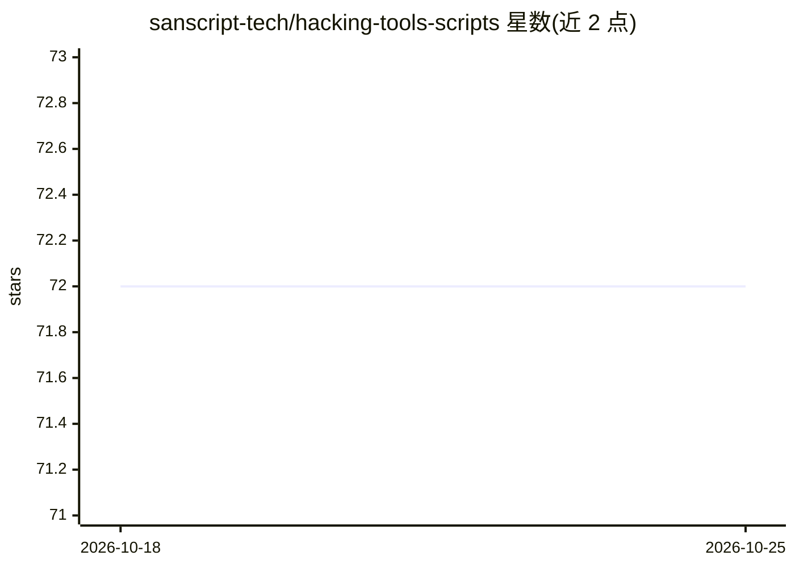

# sanscript-tech/hacking-tools-scripts

⭐ 72 · Jupyter Notebook · GPL-3.0 · 推送 2026-03-02 · [GitHub](https://github.com/sanscript-tech/hacking-tools-scripts) · 组织维护

**面向初学者的黑客工具与脚本合集（开源活动项目）**

Sanscript India 主办的 Autumn of Open Source 2020 活动旗下仓库，收集从基础到进阶的各类黑客工具与脚本，接受任意脚本语言的贡献，目的是让初学者学习开源协作。活动注册已于 2020 年截止，贡献截止于 2020 年 11 月 20 日，由多名项目负责人维护。README 未给出具体脚本清单、安装或运行说明。

## 筛选速览

| 维度 | 判定 | 备注 |
|---|---|---|
| AI 角色 | `ai-ecosystem` | LLM/agent 周边工具 |
| 许可风险 | `viral` | GPL-3.0 |
| 部署形态 | `None` |  |
| 模型依赖 | — | README 未给出锁定关系 |
| 硬件要求 | — | 无带数字的原话,不猜 |
| 安装摩擦 | `low` | 无编译、无系统依赖或容器化 |
| 成熟度 | — | 结构信号不足 |

## 能力要点

- 收录从基础到进阶的黑客工具与脚本
- 接受任意脚本语言的社区贡献
- 作为 AOS 2020 开源新手活动的实践项目，提供导师指导与证书

## 适用场景

- 初学者通过贡献脚本学习开源协作流程
- 浏览他人提交的安全类脚本示例

## 场景标签

`网络安全` · 领域:学习与行业

## 证据(README 行号)

> L25:  ## Brief about project:
> L33: ## Tech stacks used
> L35: **Any Scripting Language**

## 星数曲线

2026-10-18 72 → 2026-10-25 72（+0）

---
*卡片 v1 · prompt 1.4 · 生成 2026-10-24 · 置信度 low · 依据 README sha `0196f009685c` · [字段定义](../../DATASET.md)*
