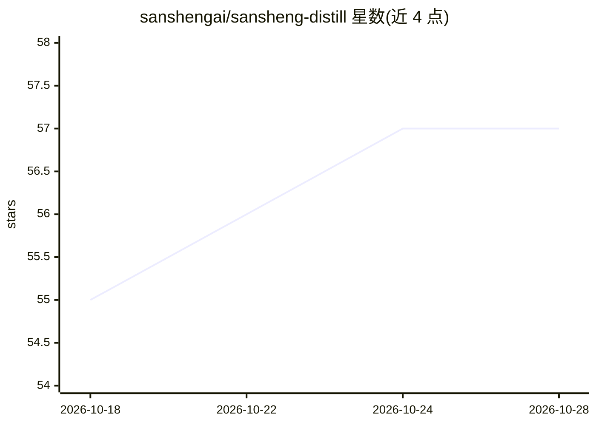

# sanshengai/sansheng-distill

⭐ 58 · Python · MIT · 推送 2026-10-24 · [GitHub](https://github.com/sanshengai/sansheng-distill) · 个人维护 · 中文 README

**把书/视频/人物资料蒸成单文件 HTML 知识地图的 Claude Code skill**

面向 Claude Code 用户的蒸馏 skill：输入 .epub/.pdf/.txt/.azw3/.mobi 或视频系列，跑多步管线生成一个可双击打开、离线可用的单文件 HTML 阅读漏斗页（速览公式、思维导图、逐章精读、行动清单、正反书评）。另含创作者观点族归并、人物传记证据库（单向证据链、human reviewer 签署门禁）与心理学证据严格域（SHA-256 溯源、verify_page.py 机器验收）。通过 claude plugin 市场或 clone+软链安装，需 Python≥3.10 与若干 pip 依赖；.azw3/.mobi 需 calibre，视频路径需 yt-dlp 等。

## 筛选速览

| 维度 | 判定 | 备注 |
|---|---|---|
| AI 角色 | `ai-native` | 本体是模型或模型工具 |
| 许可风险 | `permissive` | MIT |
| 部署形态 | `library` | 以包/库形式分发 |
| 模型依赖 | locked-api |  |
| 硬件要求 | — | 无带数字的原话,不猜 |
| 安装摩擦 | `low` | 无编译、无系统依赖或容器化 |
| 成熟度 | `idea` | |

## 能力要点

- 书/视频输入生成不依赖服务器与第三方库的单文件 HTML 知识地图
- 跨书聚合：同作者≥2 部生成思想演变页、同主题≥3 本生成分歧对照页
- 人物传记路径采用单向证据链与三层门禁，外部模型仅 recommendation_only
- 心理学严格域：claim_id + source-audit.json 锁 SHA-256，verify_page.py 机器验收

## 适用场景

- 把读过的书蒸成可交互的知识地图页便于回看
- 把一个博主的全量视频/文章/书归并成观点体系全景
- 为历史人物整理可溯源的传记证据库

## 场景标签

`知识库管理` · 领域:知识与检索

## 证据(README 行号)

> L19: 丢给它一本书(`.epub` / `.pdf` / `.txt` / `.azw3` / `.mobi`),或一组视频,它跑完一条多步管线,吐出**一个可以直接双击打开的单文件 HTML 页** -- 不联网、不依赖服务器,一个文
> L91: 对 Claude 说 *"蒸馏这本书"* *"拆这本书"* *"distill this book"* *"蒸馏这个视频系列"* *"蒸馏这个博主"* *"建立人物传记证据库"* *"核验这个历史人物的生平材料"*,或直接丢一个电
> L97: 作为 Claude Code plugin(推荐):

## 星数曲线

2026-10-18 55 → 2026-10-28 57（+2）

---
*卡片 v1 · prompt 1.4 · 生成 2026-10-24 · 置信度 mid · 依据 README sha `73122407fde6` · [字段定义](../../DATASET.md)*
