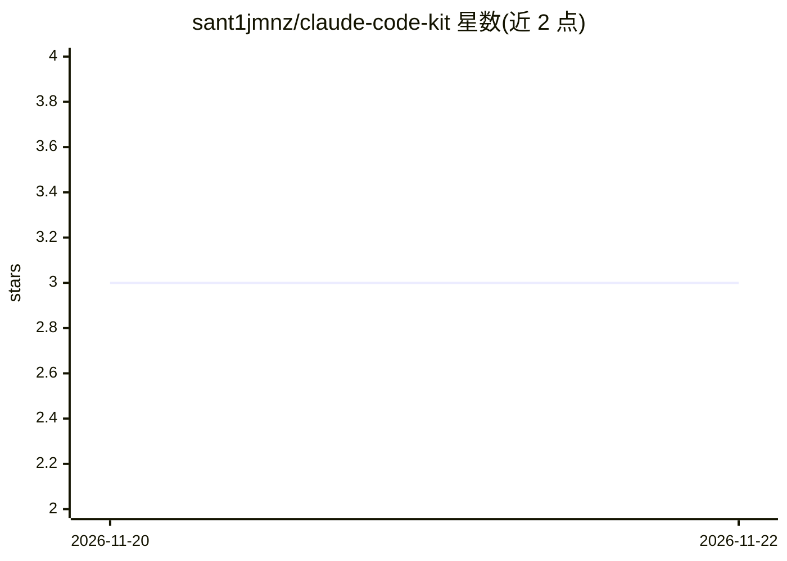

# sant1jmnz/claude-code-kit

⭐ 3 · TypeScript · MIT · 推送 2026-11-13 · [GitHub](https://github.com/sant1jmnz/claude-code-kit) · 个人维护

**为 Claude Code 用户提供配置化技能、插件与工作流的安装套件**

以 Markdown 文档为主体的 Claude Code 配置套件：安装过程交给 AI 代理执行——用户把 INSTALL.md 交给代理，由其备份配置、逐项确认后安装。内容包含反低质输出的规则、技能清单（编码/设计/营销/研究等）、插件与 MCP 服务器（superpowers、Context7、Playwright）、省 token 策略（子代理规则、模型路由、社区 mods）、基于 Markdown 的跨会话记忆系统，以及每周更新检查任务。大部分配置可移植到 Codex、Gemini CLI、Cursor 等代理。要求 Node.js 18+、git 与任一代理，跨 Windows/macOS/Linux。

## 筛选速览

| 维度 | 判定 | 备注 |
|---|---|---|
| AI 角色 | `ai-ecosystem` | LLM/agent 周边工具 |
| 许可风险 | `permissive` | MIT |
| 部署形态 | `None` |  |
| 模型依赖 | — | README 未给出锁定关系 |
| 硬件要求 | — | 无带数字的原话,不猜 |
| 安装摩擦 | `low` | 无编译、无系统依赖或容器化 |
| 成熟度 | — | 结构信号不足 |

## 能力要点

- INSTALL.md 驱动：AI 代理代办安装，改全局文件前需用户确认
- 跨会话的纯 Markdown 文件式记忆系统
- 省 token 策略：RTK、子代理规则、effort/model 路由、社区 mods
- 配置可移植至 Codex、Antigravity、Gemini CLI、Cursor 等代理

## 适用场景

- 为 Claude Code 配置一套完整的技能、插件与工作流
- 在试用或免费额度计划下减少 token 消耗
- 让代理在多次会话间记住用户偏好
- 把同类配置迁移到 Codex 或 Gemini CLI 等其他代理

## 场景标签

`编码 Agent` `提示工程` · 领域:Agent 开发

## 证据(README 行号)

> L3: A complete, battle-tested setup for **Claude Code**: curated skills, plugins, MCP servers, token-saving habits, a fi
> L5: You don't install anything by hand: you give `INSTALL.md` to your AI agent and it does the work, asking before it to

## 星数曲线

2026-11-20 3 → 2026-11-22 3（+0）

---
*卡片 v1 · prompt 1.4 · 生成 2026-11-21 · 置信度 high · 依据 README sha `00567b41a1df` · [字段定义](../../DATASET.md)*
