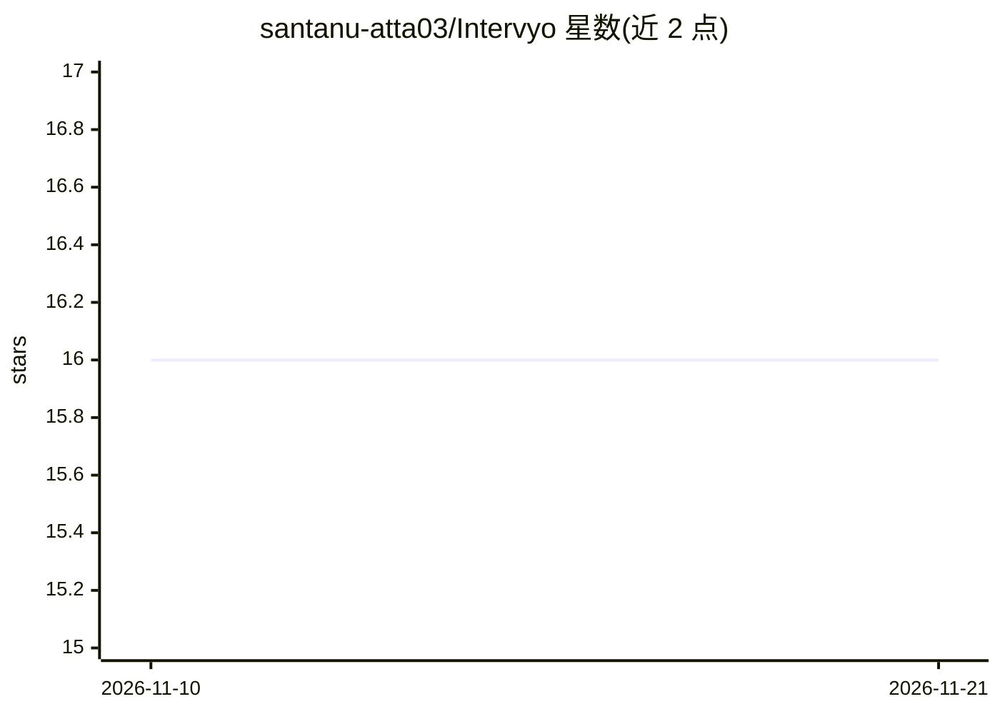

# santanu-atta03/Intervyo

⭐ 16 · JavaScript · MIT · 推送 2026-11-19 · [GitHub](https://github.com/santanu-atta03/Intervyo) · [官网](https://intervyo.tech) · 个人维护

**面向求职者的 AI 模拟面试平台，提供结构化评估与反馈**

Web 应用，用 LLM 模拟技术、行为及混合面试：限时提问、根据回答生成追问、实时肢体语言教练（眼神/姿态追踪）与置信度 HUD，按预设标准评分并给出改进建议。另含众包真题库、公司推荐引擎、弱点预测与三阶段提升计划、面试回放与笔记系统、语音练习实验室。技术栈为 React + Node.js/Express + MongoDB，需配置 AI API key，源码运行或 Docker Compose 部署。README 注明部分依赖尚不官方支持 React 19，需 --legacy-peer-deps 安装。

## 筛选速览

| 维度 | 判定 | 备注 |
|---|---|---|
| AI 角色 | `ai-native` | 本体是模型或模型工具 |
| 许可风险 | `permissive` | MIT |
| 部署形态 | `self-host` | docker 或自建部署 |
| 模型依赖 | — | README 未给出锁定关系 |
| 硬件要求 | — | 无带数字的原话,不猜 |
| 安装摩擦 | `low` | 无编译、无系统依赖或容器化 |
| 成熟度 | — | 结构信号不足 |

## 能力要点

- LLM 驱动的限时提问与自适应追问面试模拟
- 按预设标准的结构化评分与可执行反馈
- 弱点预测与 3 阶段提升计划（含成功概率评分）
- 实时肢体语言教练与置信度 HUD

## 适用场景

- 学生或开发者求职前做模拟面试练习
- 对照标准获得结构化面试反馈，定位反复出现的弱点
- 按目标公司准备并跟踪倒计时练习计划

## 场景标签

 · 领域:教育/求职准备

## 证据(README 行号)

> L3: Intervyo is an AI-driven interview preparation and evaluation platform designed to simulate real-world technical and
> L31: ### 🎤 AI Interview Simulation
> L138: - LLM-based interview logic

## 星数曲线

2026-11-10 16 → 2026-11-21 16（+0）

---
*卡片 v1 · prompt 1.4 · 生成 2026-11-18 · 置信度 high · 依据 README sha `2c3ef9cf6fae` · [字段定义](../../DATASET.md)*
