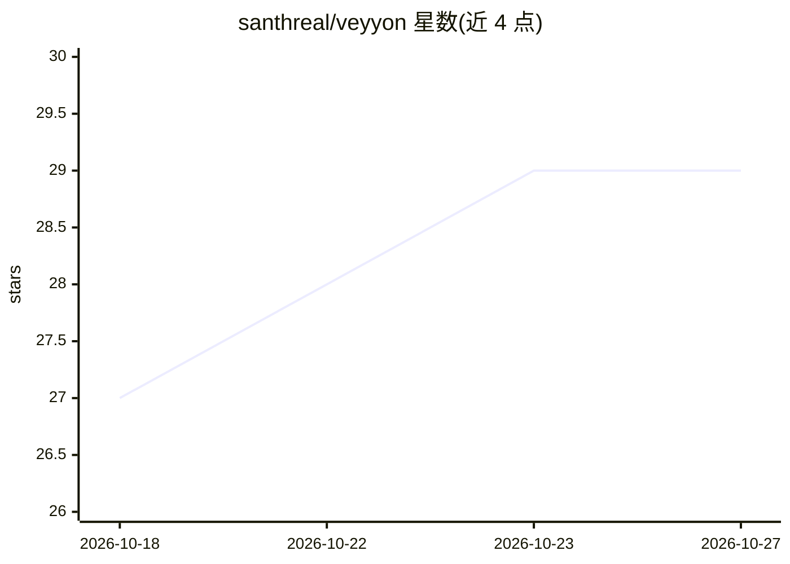

# santhreal/veyyon

⭐ 29 · TypeScript · MIT · 推送 2026-10-26 · [GitHub](https://github.com/santhreal/veyyon) · [官网](https://veyyon.dev) · 个人维护

**自带密钥的终端 AI 编程代理（CLI/TUI）**

oh-my-pi 的 MIT 许可分支，是一个运行于终端的编程代理，提供 CLI 与 TUI 两种界面，用户自带 API key 或订阅接入模型。README 描述其工作流程：生成三阶段六任务计划、将目录重构分发给并行 worker、应用编辑、在精简环境中验证环境默认项、经显式批准后通过占位符签名发布结果。安装通过 curl/PowerShell 脚本完成，安装器会校验发布校验和与二进制后再替换现有安装，并支持固定版本、更新、回滚与卸载。

## 筛选速览

| 维度 | 判定 | 备注 |
|---|---|---|
| AI 角色 | `ai-native` | 本体是模型或模型工具 |
| 许可风险 | `permissive` | MIT |
| 部署形态 | `None` |  |
| 模型依赖 | — | README 未给出锁定关系 |
| 硬件要求 | — | 无带数字的原话,不猜 |
| 安装摩擦 | `low` | 无编译、无系统依赖或容器化 |
| 成熟度 | — | 结构信号不足 |

## 能力要点

- CLI 与 TUI 双界面
- 计划生成后分发给并行 worker 执行编辑
- 发布前在精简环境中验证环境默认项
- 安装器校验发布校验和与二进制

## 适用场景

- 在终端中让 AI 代理代为执行代码重构任务
- 自带 API key/订阅使用，不在服务端托管密钥
- 通过脚本化安装与回滚机制管理本地工具版本

## 场景标签

`编码 Agent` · 领域:编码与开发

## 证据(README 行号)

> L2:  Veyyon — the terminal coding agent to end human slop.
> L8:  Veyyon stores a release key as a protected placeholder, writes a three-phase six-task plan, fans three directory re
> L27: Veyyon is a fork of oh-my-pi and is licensed under MIT LICENSE. See UPSTREAM.md for more details. Dependency licens

## 星数曲线

2026-10-18 27 → 2026-10-27 29（+2）

---
*卡片 v1 · prompt 1.4 · 生成 2026-10-26 · 置信度 mid · 依据 README sha `4d27e6aaf489` · [字段定义](../../DATASET.md)*
