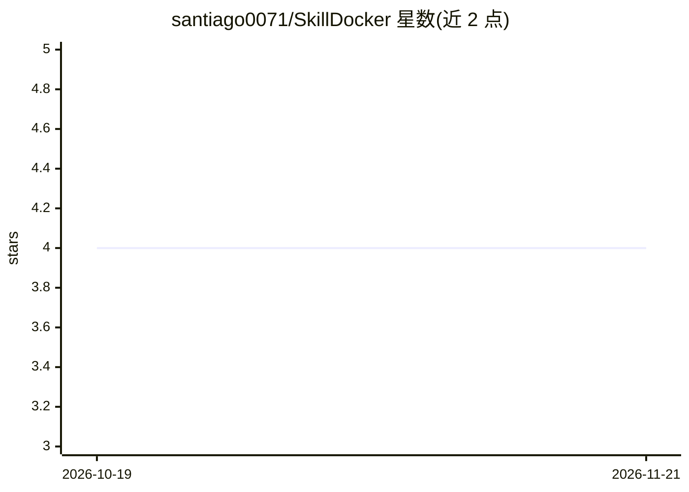

# santiago0071/SkillDocker

⭐ 4 · TypeScript · MIT · 推送 2026-10-14 · [GitHub](https://github.com/santiago0071/SkillDocker) · [官网](https://skilldocker.com) · 个人维护 · 中文 README

**多 AI 编程助手的技能管理桌面工具：集中查看、开关与热注入指令**

基于 Tauri 2.0 + Rust + React 构建的本地桌面应用，用于统一管理散落在 Claude Code、Cursor、Antigravity、Codex 各自隐藏目录中的 AI 技能文件。功能包括自动扫描汇总技能、一键开关、全局快捷键呼出输入框向当前会话注入临时指令、模板化创建技能文件（BYOK 接自己的 API key 做检查）、语法与冲突诊断。纯本地运行、宣称不上传数据；社区版 MIT，Pro 版为付费商业授权。

## 筛选速览

| 维度 | 判定 | 备注 |
|---|---|---|
| AI 角色 | `ai-ecosystem` | LLM/agent 周边工具 |
| 许可风险 | `permissive` | MIT |
| 部署形态 | `desktop` | 安装包/桌面程序 |
| 模型依赖 | — | README 未给出锁定关系 |
| 硬件要求 | — | 无带数字的原话,不猜 |
| 安装摩擦 | `medium` | 含编译或系统依赖之一 |
| 成熟度 | — | 结构信号不足 |

## 能力要点

- 跨 4 个 AI 编程工具的技能自动扫描与统一面板
- 全局快捷键（Alt+Space）热注入临时指令
- 技能文件语法体检与跨规则冲突检测
- 纯本地离线运行，内存占用约 40MB

## 适用场景

- 同时使用多个 AI 编程助手时集中管理技能
- 为运行中的 AI 会话追加不随上下文压缩丢失的临时要求
- 新手学习编写标准化的 SKILL.md 技能文件
- 排查多个技能规则间的指令冲突

## 场景标签

`提示工程` · 领域:Agent 开发

## 证据(README 行号)

> L3: > **A beginner-friendly, all-in-one lightweight desktop manager to inspect, cast, learn, and diagnose AI skills.**
> L27: - **Auto-Discovery**: Automatically scans and aggregates skills from Claude Code, Cursor, Antigravity, and Codex in
> L52: - **Zero Cloud Services**: Runs entirely on your local machine. Never uploads your source code, project paths, or p

## 星数曲线

2026-10-19 4 → 2026-11-21 4（+0）

---
*卡片 v1 · prompt 1.4 · 生成 2026-11-21 · 置信度 high · 依据 README sha `406aeb8c82f4` · [字段定义](../../DATASET.md)*
