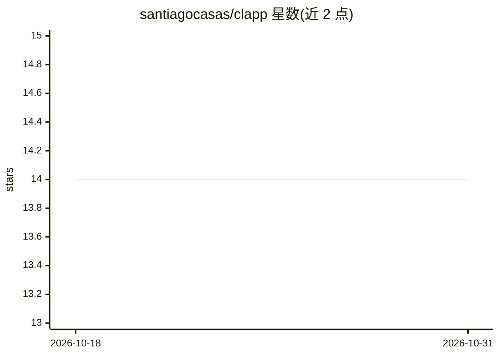

# santiagocasas/clapp

⭐ 14 · Python · MIT · 推送 2026-02-11 · [GitHub](https://github.com/santiagocasas/clapp) · [官网](https://blablaclapp.streamlit.app/) · 组织维护

**面向 CLASS 宇宙学代码的 AI 结对编程助手**

基于 Streamlit 的 Web 应用，为 CLASS 宇宙学代码提供 AI 结对编程助手：使用 LangChain 与 OpenAI/Gemini/Blablador 模型，通过 RAG 检索 CLASS 文档与代码示例（./class-data/）生成回答。支持实时执行 Python 代码片段并自动检测修正错误、生成宇宙学图表，提供 Fast 与多智能体 Swarm 两种响应模式。面向宇宙学研究者与使用 CLASS 的开发者，需至少一个模型 API key，通过 uv 管理依赖并以 git clone 源码方式部署。

## 筛选速览

| 维度 | 判定 | 备注 |
|---|---|---|
| AI 角色 | `ai-native` | 本体是模型或模型工具 |
| 许可风险 | `permissive` | MIT |
| 部署形态 | `library` | 以包/库形式分发 |
| 模型依赖 | — | README 未给出锁定关系 |
| 硬件要求 | — | 无带数字的原话,不猜 |
| 安装摩擦 | `low` | 无编译、无系统依赖或容器化 |
| 成熟度 | — | 结构信号不足 |

## 能力要点

- RAG 检索 CLASS 文档与代码生成回答
- 实时执行 Python 代码并自动修复错误
- Fast 与 Swarm（多智能体）两种响应模式
- 可选 Blablador/OpenAI/Gemini 三类模型

## 适用场景

- 学习 CLASS 宇宙学代码的参数与用法
- 编写和调试基于 CLASS 的宇宙学计算代码
- 让 AI 执行代码并生成宇宙学数据图表

## 场景标签

`代码生成` `RAG` `科研工具` · 领域:编码与开发

## 证据(README 行号)

> L17: CLAPP is a Streamlit application that provides an AI pair programming assistant specialized in the CLASS cosmology 
> L35: * **Conversational AI:** Interact with an AI assistant knowledgeable about CLASS and cosmology.

## 星数曲线

2026-10-18 14 → 2026-10-31 14（+0）

---
*卡片 v1 · prompt 1.4 · 生成 2026-10-31 · 置信度 mid · 依据 README sha `548bf5d21ddc` · [字段定义](../../DATASET.md)*
