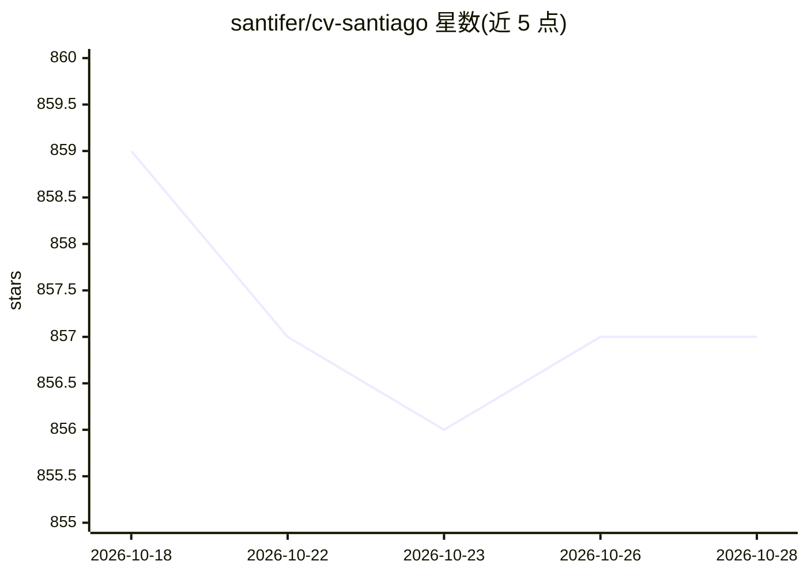

# santifer/cv-santiago

⭐ 858 · HTML · 推送 2026-10-26 · [GitHub](https://github.com/santifer/cv-santiago) · [官网](https://santifer.io) · 个人维护

**带文本+语音 AI 聊天机器人的交互式个人作品集网站**

Santiago 的生产级交互式作品集：双模式 AI 聊天机器人 "Santi"（Claude Sonnet 文本 + OpenAI Realtime 语音），以第一人称回答本人经历；RAG 采用 pgvector + BM25 混合检索与 Haiku 重排；含 6 层提示注入防御、71 项自动化评测作为 CI 门禁、基于 Langfuse + Supabase 数据的私有 LLMOps 仪表盘（8 标签页），以及线上质量分低于 0.7 自动生成测试的闭环。React 19 + TypeScript + Vite 构建，部署于 Vercel；需配置 ANTHROPIC_API_KEY、OPENAI_API_KEY 等环境变量。文本对话成本 <$0.005，语音会话约 $0.25。

## 筛选速览

| 维度 | 判定 | 备注 |
|---|---|---|
| AI 角色 | `ai-native` | 本体是模型或模型工具 |
| 许可风险 | `none` | — |
| 部署形态 | `library` | 以包/库形式分发 |
| 模型依赖 | locked-api |  |
| 硬件要求 | — | 无带数字的原话,不猜 |
| 安装摩擦 | `low` | 无编译、无系统依赖或容器化 |
| 成熟度 | — | 结构信号不足 |

## 能力要点

- 双模式聊天机器人：Claude Sonnet 文本 + OpenAI Realtime 语音，共享 RAG 管线
- 6 层提示注入防御：关键词检测、金丝雀令牌、指纹、反抽取、在线安全评分、红队
- 71 项自动化评测（10 类）作为 CI 门禁，混合确定性断言与 LLM-as-Judge
- 私有 /ops 仪表盘 8 标签页，展示 Langfuse + Supabase 真实生产数据

## 适用场景

- 通过对话向 AI 分身了解作者的经历与项目
- 参考其 RAG、评测与 LLMOps 工程实践作为个人作品集范例
- 克隆后自部署一个带语音模式的 AI 简历站点

## 场景标签

`聊天机器人` · 领域:对话与助手

## 证据(README 行号)

> L21: - **AI Chatbot "Santi"** — Text (Claude Sonnet) + Voice (OpenAI Realtime API). Responds in first person as Santiago
> L24: - **LLMOps Dashboard** — Private `/ops` with 8 tabs: Overview, Conversations, Costs, RAG, Security, Evals, Voice, S

## 星数曲线

2026-10-18 859 → 2026-10-28 857（-2）

---
*卡片 v1 · prompt 1.4 · 生成 2026-10-21 · 置信度 high · 依据 README sha `2e5b2c9f8476` · [字段定义](../../DATASET.md)*
