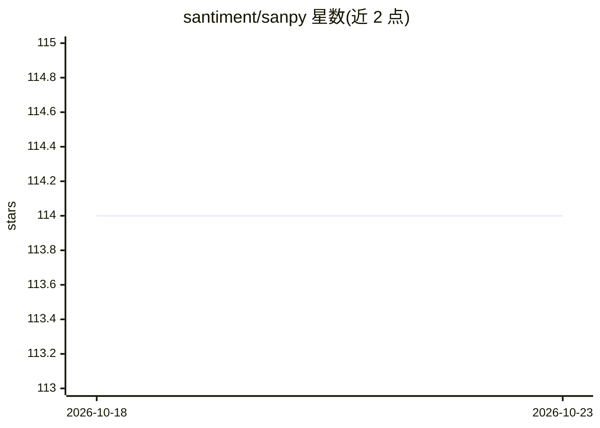

# santiment/sanpy

⭐ 114 · Python · MIT · 推送 2026-10-02 · [GitHub](https://github.com/santiment/sanpy) · 组织维护

**Santiment API 的 Python 客户端：获取 3000+ 加密资产数据**

Santiment API 的 Python 客户端库，提供链上、社交、开发活动与价格等加密资产指标数据的访问，覆盖 3000+ 资产。结果以 datetime 索引的 pandas DataFrame 返回。提供 san.get / san.get_many 时序查询、selector 灵活定位（地址/组织/持有人）、原始 GraphQL 查询、针对 ClickHouse 的 SQL 查询（execute_sql），以及 san 命令行界面。含重试、超时与连接池配置。免费层限制近 30 天数据与部分指标，完整数据需付费 SanAPI 计划与 API key。

## 筛选速览

| 维度 | 判定 | 备注 |
|---|---|---|
| AI 角色 | `ai-knowledge` | 知识聚合/清单类 |
| 许可风险 | `permissive` | MIT |
| 部署形态 | `self-host` | docker 或自建部署 |
| 模型依赖 | — | README 未给出锁定关系 |
| 硬件要求 | — | 无带数字的原话,不猜 |
| 安装摩擦 | `low` | 无编译、无系统依赖或容器化 |
| 成熟度 | — | 结构信号不足 |

## 能力要点

- san.get / san.get_many 时序查询，结果为 pandas DataFrame
- 支持原始 GraphQL 查询与 ClickHouse SQL 查询（execute_sql）
- san CLI：免写代码获取指标、配置 key、查询限额
- 内置 HTTP 会话复用与瞬时故障自动重试（408/5xx）

## 适用场景

- 用 Python 拉取加密资产的链上/社交/价格指标做分析
- 对 Santiment ClickHouse 数据库跑自定义 SQL
- 通过命令行快速查询指标而不用写脚本

## 场景标签

 · 领域:区块链/金融数据

## 证据(README 行号)

> L5: Python client library for the Santiment API — access on-chain, social, development, and price metrics for 3000+ cryp
> L359: san.execute_sql(query="SELECT * FROM daily_metrics_v2 LIMIT 5")

## 星数曲线

2026-10-18 114 → 2026-10-23 114（+0）

---
*卡片 v1 · prompt 1.4 · 生成 2026-10-23 · 置信度 low · 依据 README sha `0355b94f93c7` · [字段定义](../../DATASET.md)*
