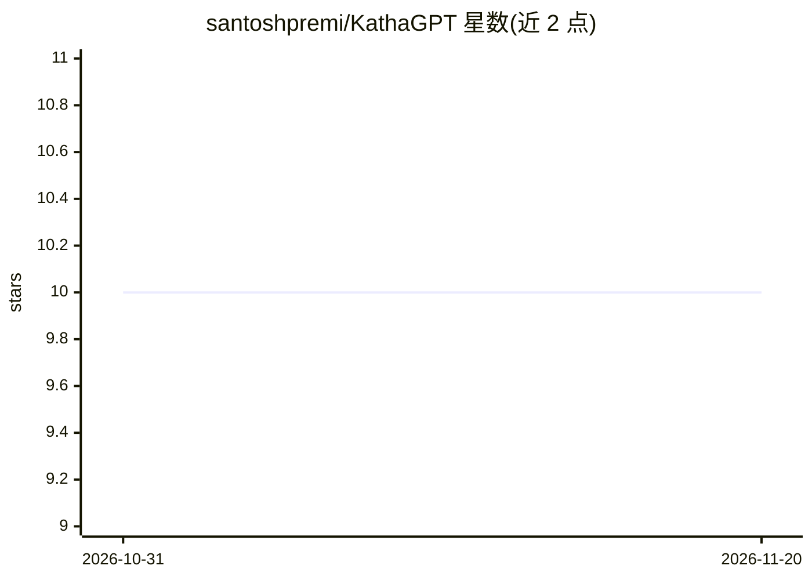

# santoshpremi/KathaGPT

⭐ 10 · TypeScript · MIT · 推送 2026-08-02 · [GitHub](https://github.com/santoshpremi/KathaGPT) · [官网](https://santoshpremi.github.io/KathaGPT/) · 个人维护

**本地运行的私有 AI 桌面聊天应用，无需 API key**

基于 Rust (Axum) + Tauri v2 + React + SQLite 的桌面 AI 聊天应用，内置 llama.cpp 引擎按需下载运行时与 .gguf 模型，全程本地推理，对话数据存于设备；也支持 BYOK 接入 OpenRouter、OpenAI、Anthropic 等云服务。提供 18 个按 RAM 分档的精选量化模型、流式聊天、研究助手/翻译/图像生成等工具，以及文档 RAG v1（fastembed + 混合检索 + 引用）。macOS/Windows/Linux 提供 .dmg/.msi/.AppImage 安装包，源码运行需 Node.js、pnpm 与 Rust。

## 筛选速览

| 维度 | 判定 | 备注 |
|---|---|---|
| AI 角色 | `ai-native` | 本体是模型或模型工具 |
| 许可风险 | `permissive` | MIT |
| 部署形态 | `desktop` | 安装包/桌面程序 |
| 模型依赖 | local-ok | 支持本地模型 |
| 硬件要求 | — | 无带数字的原话,不猜 |
| 安装摩擦 | `medium` | 含编译或系统依赖之一 |
| 成熟度 | — | 结构信号不足 |

## 能力要点

- 内置 llama.cpp sidecar，应用内一键下载 18 个精选 .gguf 模型，无需终端与外部安装
- GPU 加速自动适配：Apple Silicon 走 Metal、NVIDIA 走 CUDA、其余 CPU 回退
- API 仅绑定 127.0.0.1:17890 回环地址，API key 本地存储并掩码显示
- 文档 RAG v1：上传分块 → fastembed 向量 + FTS/BM25 混合检索 → 带引用回答

## 适用场景

- 在本地机器上隐私运行 LLM 聊天，对话不出设备
- 按可用内存选择并下载合适大小的本地模型
- 通过 BYOK 在同一客户端切换 OpenRouter/OpenAI 等云模型
- 对上传文档做带引用的检索问答

## 场景标签

`聊天机器人` `图像生成` `RAG` · 领域:对话与助手

## 证据(README 行号)

> L5: **Fast, private AI chat on your machine — powered by Rust.** Run local AI models with no API key, or bring your own 
> L15: |**Stack**|React · **Rust (Axum)** · Tauri v2 · SQLite · llama.cpp|
> L22: > Click **Add Local Model** → search → **Download** → chat. No terminal, no Ollama, no external installs.

## 星数曲线

2026-10-31 10 → 2026-11-20 10（+0）

---
*卡片 v1 · prompt 1.4 · 生成 2026-11-19 · 置信度 high · 依据 README sha `7566a4bfca95` · [字段定义](../../DATASET.md)*
