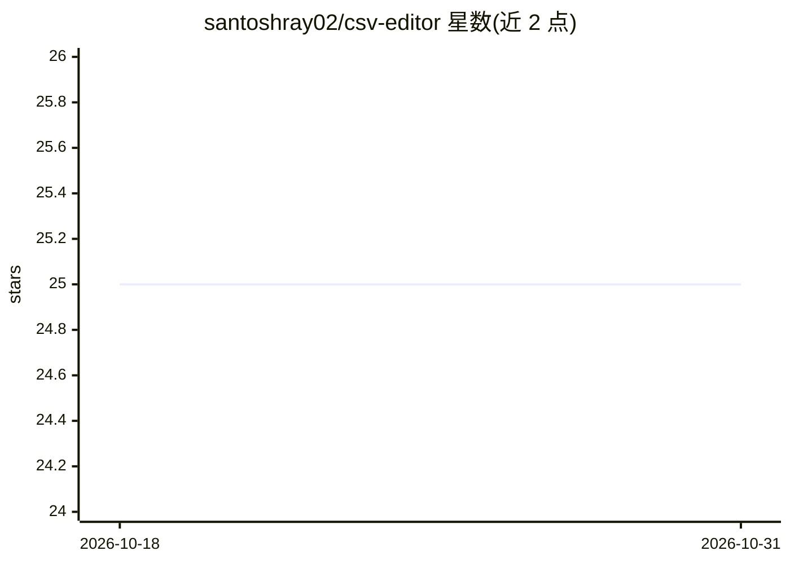

# santoshray02/csv-editor

⭐ 25 · Python · MIT · 推送 2026-07-14 · [GitHub](https://github.com/santoshray02/csv-editor) · [官网](https://santoshray02.github.io/csv-editor/) · 个人维护

**给 AI 助手的有状态 CSV 编辑 MCP 服务器（39 个工具）**

基于 FastMCP 3 的 MCP 服务器，向 Claude Desktop、Claude Code、Cursor、Windsurf 等 MCP 客户端提供 39 个 pandas 驱动的 CSV 工具：加载/导出（CSV/JSON/Excel/Parquet 等）、过滤排序透视、去重与缺失值处理、统计与离群检测、schema 校验与质量评分。核心机制是会话隔离、undo/redo 历史与四种自动保存策略；v2.0.0 要求 Python 3.11+，SSE 传输已移除改用 Streamable HTTP。适用文件规模为 <1 GB（pandas），超大文件场景 README 指向 DuckDB 类方案。

## 筛选速览

| 维度 | 判定 | 备注 |
|---|---|---|
| AI 角色 | `ai-ecosystem` | LLM/agent 周边工具 |
| 许可风险 | `permissive` | MIT |
| 部署形态 | `library` | 以包/库形式分发 |
| 模型依赖 | locked-api |  |
| 硬件要求 | — | 无带数字的原话,不猜 |
| 安装摩擦 | `low` | 无编译、无系统依赖或容器化 |
| 成熟度 | — | 结构信号不足 |

## 能力要点

- 39 个 MCP 工具覆盖 I/O、转换、分析、校验、自动保存与历史
- 会话隔离 + undo/redo（含时间旅行恢复到指定操作）
- 四种自动保存策略（overwrite/backup/versioned/custom）
- 支持 CSV/JSON/Excel/Parquet/HTML/Markdown 多格式导入导出

## 适用场景

- 让 Claude/Cursor 等 AI 客户端直接加载、清洗并保存 CSV 修改
- 数据质量校验：schema 检查、异常检测与质量评分
- ETL 场景下从 URL 拉取数据、多源合并与转换

## 场景标签

`数据分析` · 领域:效率与自动化

## 证据(README 行号)

> L12: **Stateful CSV editing for AI assistants.** CSV Editor is an MCP server that gives Claude, ChatGPT, Cursor, Windsur
> L35: CSV Editor bridges this gap by providing AI assistants with 39 specialized tools for CSV operations, turning them i

## 星数曲线

2026-10-18 25 → 2026-10-31 25（+0）

---
*卡片 v1 · prompt 1.4 · 生成 2026-10-26 · 置信度 high · 依据 README sha `74de7b9c8429` · [字段定义](../../DATASET.md)*
