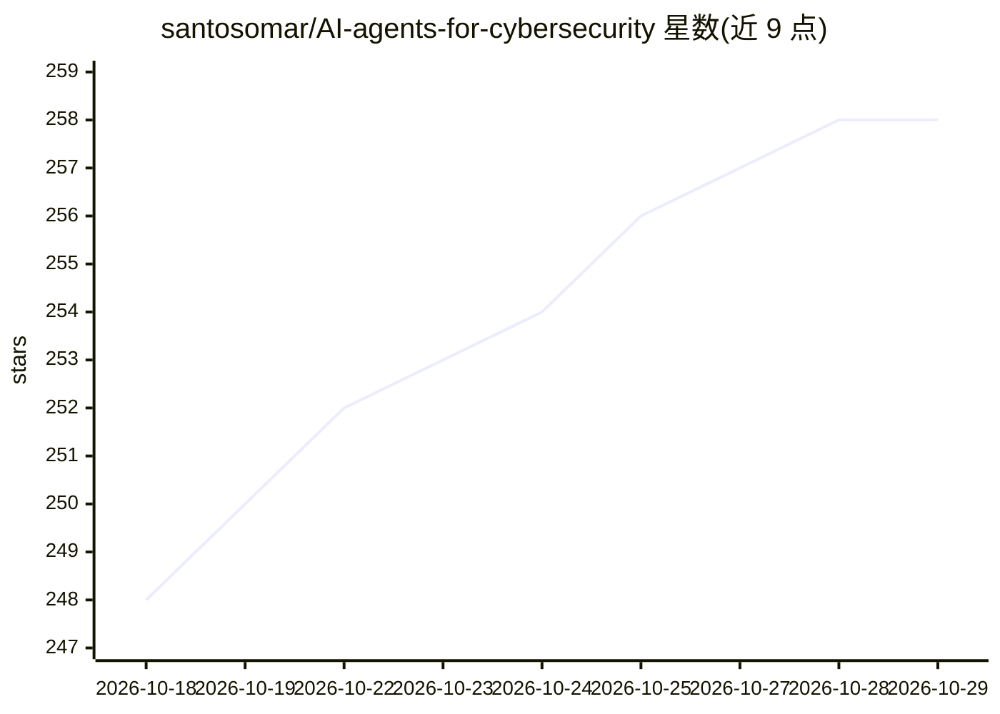

# santosomar/AI-agents-for-cybersecurity

⭐ 258 · Python · BSD-3-Clause · 推送 2026-10-26 · [GitHub](https://github.com/santosomar/AI-agents-for-cybersecurity) · 个人维护

**面向安全团队的 AI agent 实战代码、实验与参考资料库**

Omar Santos 维护的伴生代码仓库，服务于其培训课程、视频课程与书籍。内容分八部分：基础模型交互与嵌入、提示工程、LCEL 提示链、RAG 实现（Chroma 向量库）、AI agent 与 MCP 安全服务器、六个安全团队 agentic 框架评估指南、agent 成本（tokenomics）分析与多 agent 安全评估规格（非可运行代码，含人工审批门与 kill switch）。使用 Python 3.13+ 与 uv 管理，部分示例集成 OpenAI、Hugging Face、Ollama。警告部分示例会作用于真实系统，需在授权环境中运行。

## 筛选速览

| 维度 | 判定 | 备注 |
|---|---|---|
| AI 角色 | `ai-knowledge` | 知识聚合/清单类 |
| 许可风险 | `permissive` | BSD-3-Clause |
| 部署形态 | `None` |  |
| 模型依赖 | local-ok | 支持本地模型 |
| 硬件要求 | — | 无带数字的原话,不猜 |
| 安装摩擦 | `low` | 无编译、无系统依赖或容器化 |
| 成熟度 | — | 结构信号不足 |

## 能力要点

- 八部分结构：从基础 AI 概念到多 agent 安全评估规格
- FastMCP 安全服务器（nmap、CISA KEV、Shodan）与 MCP client agents
- 六个 agentic 框架（OpenClaw、Hermes 等）的安全团队选型指南
- Part 8 提供带人工审批门与 kill switch 的评估 harness 设计规格

## 适用场景

- 跟着培训课程或书籍做配套实验与代码练习
- 安全团队评估与选择 agentic 框架
- 构建面向网络安全自动化的 agent 与 MCP 服务器
- 分析 agent 运行成本与提示缓存策略

## 场景标签

`网络安全` `教程课程` `RAG` · 领域:知识与检索

## 证据(README 行号)

> L13: Hands-on code, labs, and reference material by Omar Santos for building, securing, and operating AI agents in cyber
> L17: This is the companion repository for several of Omar's training programs and publications:
> L19: - **Pearson live trainings**: instructor-led sessions on AI agents, agentic AI security, RAG, and MCP

## 星数曲线

2026-10-18 248 → 2026-10-29 258（+10）

---
*卡片 v1 · prompt 1.4 · 生成 2026-10-22 · 置信度 high · 依据 README sha `a80e85be1f55` · [字段定义](../../DATASET.md)*
